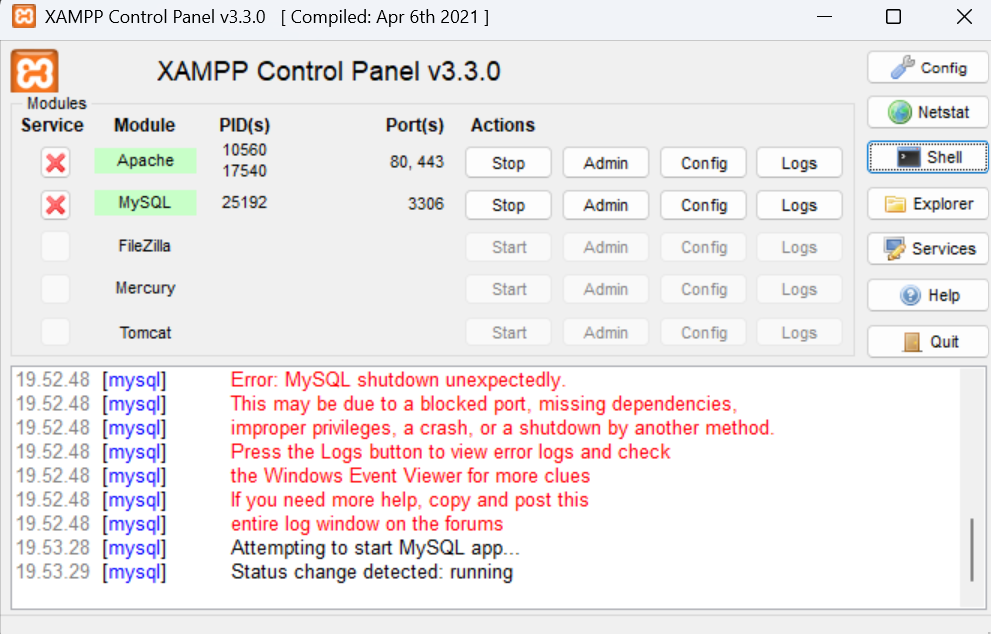
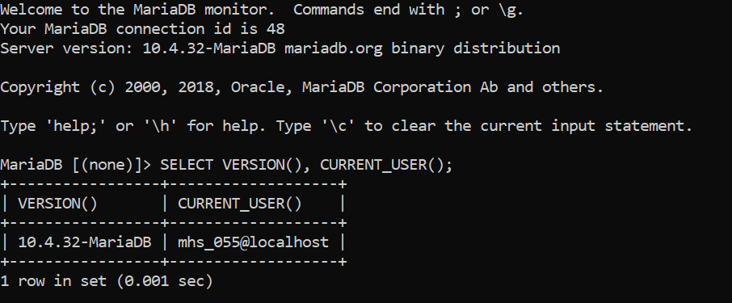
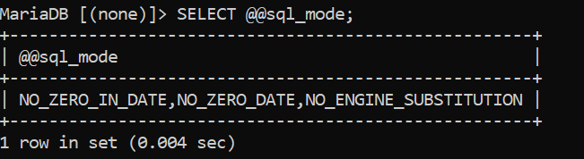
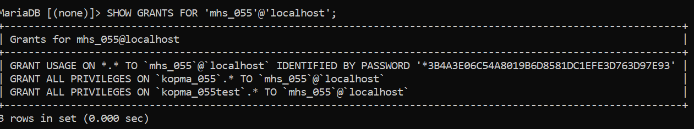
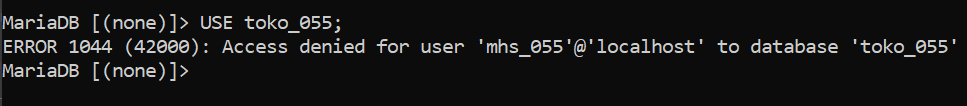
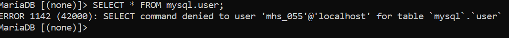
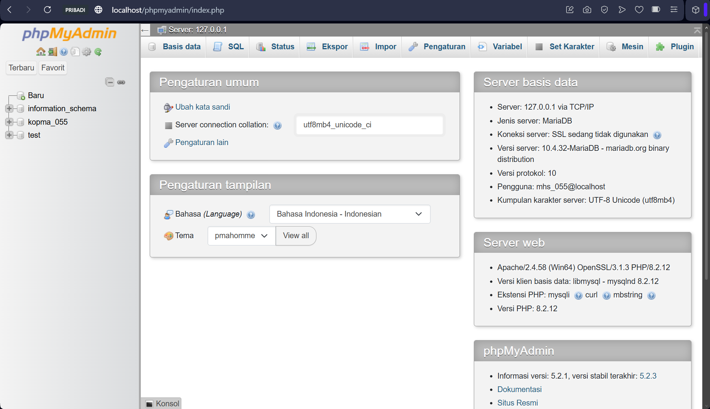

# Laporan Praktikum Basis Data - Pertemuan 01

- Nama: Raihan Ardani
- NIM: 25430055
- Kelas: C
- Mata Kuliah: Praktikum Basis Data
- Pertemuan: 1
- Dosen Pengampu: Dedi Irawan, S.Kom., M.T.I

## 1. Tujuan Praktikum

Menyiapkan lingkungan kerja MariaDB melalui XAMPP, memeriksa konfigurasi
server, membuat basis data dan akun kerja dengan hak akses terbatas,
serta menyiapkan repositori Git dan GitHub untuk menyimpan hasil
praktikum.

## 2. Ringkasan Dasar Teori

MariaDB adalah sistem manajemen basis data relasional yang dapat diakses
menggunakan SQL. XAMPP menyediakan lingkungan lokal untuk menjalankan
layanan basis data dan phpMyAdmin sebagai antarmuka berbasis web. Hak
akses akun perlu dibatasi sesuai kebutuhan agar pengguna hanya dapat
mengakses basis data yang menjadi tanggung jawabnya. Git mencatat
perubahan berkas melalui commit, sedangkan GitHub menyimpan repositori
secara daring sehingga proses kerja dapat ditinjau.

## 3. Hasil Langkah Percobaan (tangkapan layar + keterangan)

### 3.1 XAMPP dan layanan MariaDB




### 3.2 Pemeriksaan versi dan akun MariaDB

Perintah yang dijalankan:

``` sql
SELECT VERSION(), CURRENT_USER();
```

Hasil yang tercatat:

``` text
VERSION(): 10.4.32-MariaDB
CURRENT_USER(): root@localhost
```



### 3.3 Pemeriksaan mode SQL

Perintah yang dijalankan:

``` sql
SELECT @@sql_mode;
```

Hasil yang tercatat:

``` text
NO_ZERO_IN_DATE,NO_ZERO_DATE,NO_ENGINE_SUBSTITUTION
```



**Keterangan:** Hasil menunjukkan mode SQL yang aktif pada server saat
pemeriksaan dilakukan.

### 3.4 Pengujian hak akses akun kerja

Akun praktikum `mhs_055` digunakan untuk basis data `kopma_055`,

Perintah pemeriksaan hak akses:

``` sql
SHOW GRANTS FOR 'mhs_055'@'localhost';
```










### 3.5 Login phpMyAdmin dengan mode cookie

Konfigurasi autentikasi phpMyAdmin diubah menjadi `cookie`, lalu login
diuji melalui `http://localhost/phpmyadmin`.



### 3.6 Push pertama ke GitHub

Repositori lokal dibuat dan dihubungkan ke GitHub. Berkas yang
diperlukan ditambahkan, lalu commit pertama dikirim menggunakan
`git push`.


## 4. Jawaban Titik Analisis

### Titik Analisis 1 --- Label MySQL pada XAMPP

Walaupun tombol di XAMPP diberi label "MySQL", versi yang digunakan pada
praktikum ini menjalankan MariaDB. Hal ini penting ketika mencari solusi
galat di internet karena beberapa fitur, sintaks, atau pesan galat dapat
berbeda menurut versi dan produk. Dokumentasi MySQL masih dapat membantu
untuk konsep SQL umum dan fitur yang kompatibel. Namun, jika pembahasan
menyangkut perilaku khusus MariaDB atau versi server yang digunakan,
dokumentasi MariaDB dan hasil uji pada MariaDB 10.4.32 perlu dijadikan
acuan utama.

### Titik Analisis 2 --- Login root tanpa opsi `-p`

Ketika klien dijalankan dengan `mysql -u root` setelah akun root diberi
password, server menolak login karena klien tidak mengirimkan password.
Bagian pesan galat yang menyebut `using password: NO` menunjukkan bahwa
password tidak dikirim. Sebaliknya, `using password: YES` menunjukkan
bahwa klien mengirimkan password, tetapi autentikasi masih dapat gagal
jika password yang diberikan salah atau tidak sesuai.

### Titik Analisis 3 --- `information_schema`, basis data `mysql`, dan galat 1044/1045

`information_schema` berisi metadata tentang objek basis data dan dapat
terlihat oleh akun biasa untuk kebutuhan informasi tertentu. Basis data
sistem `mysql` berisi tabel internal yang tidak boleh diakses bebas oleh
akun kerja. Karena itu, akun `mhs_055` dapat melihat
`information_schema`, tetapi dapat ditolak saat mencoba mengakses
`mysql` tanpa hak yang sesuai.

Galat **1044** menunjukkan bahwa akun tidak memiliki izin untuk
mengakses basis data yang diminta. Galat **1045** menunjukkan bahwa
proses login ditolak, misalnya karena nama akun, host, atau password
tidak sesuai. Jadi, 1044 berkaitan dengan otorisasi akses basis data,
sedangkan 1045 berkaitan dengan autentikasi saat masuk.

### Titik Analisis 4 --- Keamanan mode cookie pada phpMyAdmin

Mode cookie lebih aman dibandingkan mode `config` karena pengguna harus
memasukkan kredensial saat login, sementara mode `config` dapat
menyimpan kredensial di berkas konfigurasi dan melakukan login otomatis.
Penyimpanan password di berkas konfigurasi meningkatkan risiko jika
berkas tersebut dapat dibaca pihak yang tidak berwenang. Mode cookie
mengurangi risiko tersebut, tetapi password tetap harus dijaga dan
phpMyAdmin sebaiknya hanya diakses melalui lingkungan yang tepercaya.

### Perbedaan galat 1044, 1045, dan 1142

  -----------------------------------------------------------------------
  Kode galat              Makna umum              Contoh situasi
  ----------------------- ----------------------- -----------------------
  `1044`                  Akses ke basis data     Akun `mhs_055` mencoba
                          ditolak                 menggunakan basis data
                                                  `mysql` yang bukan
                                                  haknya.

  `1045`                  Login ditolak           Username, host, atau
                                                  password tidak cocok,
                                                  atau password wajib
                                                  tetapi tidak dikirim.

  `1142`                  Operasi tertentu        Akun tidak memiliki hak
                          ditolak pada suatu      `SELECT`, `INSERT`,
                          tabel                   `UPDATE`, atau operasi
                                                  lain yang sedang dicoba
                                                  pada tabel tersebut.
  -----------------------------------------------------------------------

## 5. Hasil Latihan dan Modifikasi

### 5.1 Pemeriksaan versi dan mode SQL

Perintah berikut digunakan untuk memeriksa versi server, akun aktif, dan
mode SQL:

``` sql
SELECT VERSION(), CURRENT_USER();
SELECT @@sql_mode;
```

Versi server yang tercatat adalah MariaDB `10.4.32`. Mode SQL yang
tercatat adalah `NO_ZERO_IN_DATE,NO_ZERO_DATE,NO_ENGINE_SUBSTITUTION`.
Hasil tersebut adalah hasil pemeriksaan yang dicatat pada lingkungan
praktikum.

### 5.2 Basis data dan akun

Nama objek yang digunakan:

  Jenis                  Nama
  ---------------------- -------------
  Basis data praktikum   `kopma_055`
  Akun praktikum         `mhs_055`
  Basis data proyek      `toko_055`
  Akun proyek            `dev_055`

Basis data dibuat menggunakan charset `utf8mb4` dan collation
`utf8mb4_unicode_ci`. Hak akses masing-masing akun dibatasi pada basis
data yang sesuai.

### 5.3 Berkas lingkungan praktikum

Berkas `p01_lingkungan_25430055.sql` disiapkan untuk mendokumentasikan
perintah pemeriksaan, pembuatan basis data, pembuatan akun, dan
pemberian hak akses. Password asli tidak dicantumkan di berkas yang
di-commit ke repositori.

### 5.4 README dan `.gitignore`

Repositori dilengkapi `README.md` yang berisi identitas proyek dan
lingkungan perangkat lunak, serta `.gitignore` untuk mencegah berkas
sementara, log, dan konfigurasi lokal yang tidak perlu masuk ke Git.

## 6. Tugas Mandiri: Milestone Proyek 1

Tema proyek berdasarkan dua digit terakhir NIM adalah **Toko Daring**.
Basis data proyek bernama `toko_055`, dan akun proyek bernama `dev_055`.

Lingkup awal proyek meliputi katalog produk, keranjang belanja, pesanan,
pembayaran, dan pengiriman.

Berkas utama pada repositori:

-   `README.md`
-   `.gitignore`
-   `p01_lingkungan_25430055.sql`
-   `laporan/p01_laporan_25430055.md`

Repositori GitHub: https://github.com/raihanar575-cmd/basisdata-25430055

## 7. Pembahasan dan Kendala

Selama penyiapan, salah satu kendala adalah menjalankan perintah SQL di
Command Prompt biasa. Perintah seperti `SELECT` harus dijalankan setelah
masuk ke klien MariaDB atau melalui tab SQL di phpMyAdmin, bukan
langsung di prompt Windows biasa.

Kendala lain yang ditemui adalah login phpMyAdmin setelah password root
diatur dan pengaturan hak akses akun kerja. Masalah tersebut diperiksa
dengan memastikan metode autentikasi phpMyAdmin menggunakan mode cookie,
login memakai akun yang benar, serta akun dibuat dan diberi hak akses
melalui root.

## 8. Kesimpulan

Praktikum ini menyiapkan lingkungan kerja MariaDB, basis data praktikum
dan proyek, serta akun dengan hak akses terbatas. Repositori GitHub juga
disiapkan untuk menyimpan skrip dan dokumentasi secara teratur. Hasil
P01 menjadi dasar untuk melanjutkan analisis kebutuhan data pada P02.

## 9. Pernyataan Penggunaan AI

AI digunakan untuk membantu memahami konsep MariaDB dan Git, menjelaskan
pesan galat, serta meninjau struktur dan bahasa laporan. Konfigurasi dan
hasil praktikum perlu diperiksa berdasarkan hasil yang benar-benar
diperoleh.

## 10. Bukti Git (tautan repositori + hash commit)

-   **Repositori:**
    https://github.com/raihanar575-cmd/basisdata-25430055
-   **Pesan commit P01:**
    `p01: inisialisasi repositori dan skrip lingkungan`

### Checklist khusus Pertemuan 1

-   [x] `p01_lingkungan_25430055.sql` dapat dijalankan ulang dan tidak
    berisi password asli.
-   [x] `README.md` berisi Identitas Proyek.
-   [x] `.gitignore` tersedia.
-   [x] Screenshot `SELECT VERSION(), CURRENT_USER();`.
-   [x] Screenshot `SELECT @@sql_mode;`.
-   [x] Screenshot `SHOW DATABASES` sebagai `mhs_055` dan `dev_055`.
-   [x] Screenshot galat `1044` dan `1142`.
-   [x] Screenshot login phpMyAdmin dengan mode cookie.
-   [x] Screenshot push pertama ke GitHub.
-   [x] Titik Analisis 1--4 dijawab.
-   [x] Perbedaan galat `1044`, `1045`, dan `1142` dijelaskan.
>>>>>>> 4a48e0a (p01: revisi laporan dan bukti praktikum)
