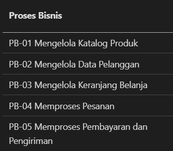
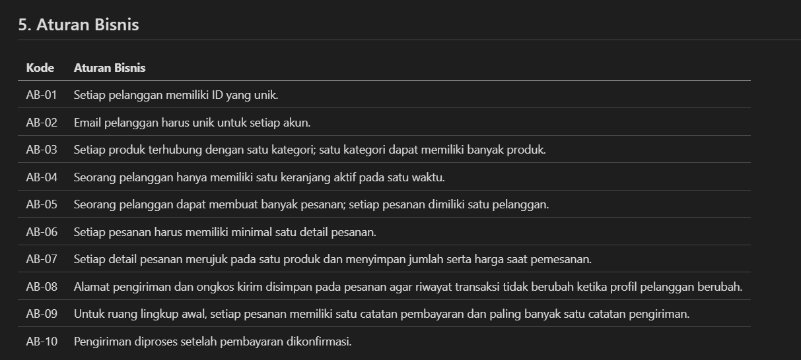
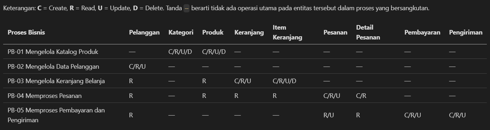
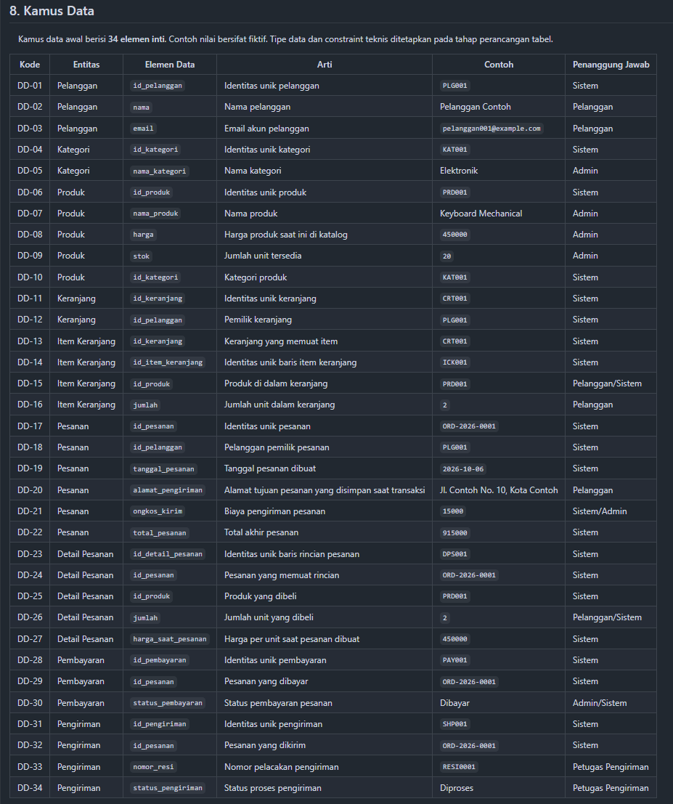

# Laporan Praktikum Basis Data — Pertemuan 02

- Nama: Raihan Ardani
- NIM: 25430055
- Kelas: C
- Mata Kuliah: Praktikum Basis Data
- Pertemuan: 2
- Dosen Pengampu: Dedi Irawan, S.Kom., M.T.I

## 1. Tujuan Praktikum

Praktikum ini bertujuan menganalisis kebutuhan data dengan mengidentifikasi aktor, proses bisnis, entitas kandidat, aturan bisnis, kebutuhan informasi, matriks CRUD, kamus data, kebutuhan nonfungsional, dan isu kualitas data. Hasil analisis digunakan sebagai dasar perancangan ERD pada pertemuan berikutnya.

## 2. Ringkasan Dasar Teori

Analisis kebutuhan data dilakukan untuk mengetahui data apa yang perlu disimpan dan informasi apa yang perlu dihasilkan oleh suatu sistem. Proses bisnis menggambarkan aktivitas organisasi, sedangkan aturan bisnis menjelaskan ketentuan yang harus dipatuhi. Kebutuhan informasi merumuskan pertanyaan yang perlu dijawab oleh sistem. Matriks CRUD menunjukkan operasi Create, Read, Update, dan Delete pada entitas dalam setiap proses bisnis. Kamus data menjelaskan arti elemen data dan pihak yang bertanggung jawab. Kebutuhan nonfungsional mencakup hal seperti volume data, retensi, privasi, dan hak akses.

## 3. Hasil Langkah Percobaan

### 3.1 Analisis kebutuhan data proyek Toko Daring

Dokumen `p02_kebutuhan_data_25430055.md` disusun untuk proyek toko daring dengan kode `toko_055`. Dokumen revisi memuat lima proses bisnis: mengelola katalog produk, mengelola data pelanggan, mengelola keranjang belanja, memproses pesanan, serta memproses pembayaran dan pengiriman.

Ruang lingkup analisis mencakup sembilan entitas kandidat, yaitu Pelanggan, Kategori, Produk, Keranjang, Item Keranjang, Pesanan, Detail Pesanan, Pembayaran, dan Pengiriman. Dokumen juga memuat aturan bisnis, kebutuhan informasi, matriks CRUD, kamus data, kebutuhan nonfungsional, isu kualitas data, parameter P, serta perbaikan pernyataan kebutuhan yang kabur.

### 3.2 Dokumen latihan Kopma

Dokumen `p02_kebutuhan_data_kopma_25430055.md` digunakan untuk latihan analisis kebutuhan pada skenario Koperasi Mahasiswa. Dokumen tersebut memuat tujuh proses bisnis: mendaftarkan anggota, mengelola barang, melayani penjualan, mengelola data petugas, mengelola pemasok, mencatat pembelian stok, dan memantau operasional.

Entitas kandidatnya terdiri atas Anggota, Barang, Penjualan, Detail Penjualan, Petugas, Pemasok, Pembelian, dan Detail Pembelian. Contoh nota penjualan yang digunakan merupakan dokumen fiktif untuk mengidentifikasi elemen seperti nomor nota, waktu transaksi, kasir, anggota bila ada, barang, kuantitas, harga saat transaksi, diskon, total pembayaran, serta poin loyalitas. Contoh tersebut bukan bukti transaksi nyata.

**Bukti screenshot dokumen Kopma (jika diminta dalam instruksi praktikum):**  
[Masukkan screenshot tabel atau bagian yang diminta dari halaman GitHub]

### 3.3 Dokumen sumber proyek Toko Daring

Dokumen sumber proyek berupa nota pesanan fiktif dengan nomor `ORD-2026-0001`, tanggal 6 Oktober 2026, satu produk Keyboard Mechanical, jumlah satu, harga saat pemesanan Rp450.000, ongkos kirim Rp15.000, dan total Rp465.000. Data pelanggan, email, dan alamat pada nota adalah contoh rekaan.

Dari nota tersebut, elemen data dapat dikelompokkan menjadi pelanggan, pesanan, detail pesanan, pembayaran, dan pengiriman. Harga produk pada katalog dibedakan dari harga yang tersimpan pada detail pesanan agar perubahan harga katalog tidak mengubah riwayat transaksi. Alamat pengiriman dan ongkos kirim disimpan pada pesanan untuk merepresentasikan kondisi saat transaksi dibuat.

## 4. Jawaban Titik Analisis

### Titik Analisis 1 — Mengapa harga saat transaksi perlu disimpan?

Harga saat transaksi perlu disimpan pada detail pesanan, bukan hanya mengacu pada harga produk yang sedang berlaku di katalog. Harga katalog dapat berubah setelah pembelian, sedangkan riwayat transaksi harus tetap menunjukkan harga yang disepakati saat pesanan dibuat. Karena itu, detail pesanan menyimpan produk, jumlah, dan harga saat pemesanan.

### Titik Analisis 2 — Bagaimana total pesanan ditentukan?

Subtotal detail pesanan dihitung dari jumlah barang dikalikan harga satuan saat transaksi. Total pesanan perlu menghitung subtotal seluruh detail, kemudian menambahkan ongkos kirim dan memperhitungkan diskon bila memang berlaku. Contoh nota Toko Daring dalam dokumen menggunakan satu produk: Rp450.000 + Rp15.000 ongkos kirim = Rp465.000. Contoh ini tidak menerapkan diskon.

### Titik Analisis 3 — Apa yang perlu diperiksa pada matriks CRUD?

Setiap entitas perlu memiliki proses bisnis yang menjelaskan bagaimana data dibuat dan digunakan. Jika sebuah entitas tidak memiliki operasi Create, perlu diperiksa apakah proses pembentukan datanya belum dituliskan atau apakah entitas tersebut memang tidak diperlukan dalam ruang lingkup awal. Matriks CRUD proyek diperiksa dengan mencocokkan entitas dengan proses yang terkait. Matriks bukan pengganti ERD; hubungan dan kardinalitas akan diperiksa kembali pada P03.

## 5. Hasil Latihan dan Modifikasi

### 5.1 Perhitungan parameter P

Dua digit terakhir NIM adalah **55**, sehingga:

\[
P = (55 \bmod 9) + 1 = 1 + 1 = 2
\]

Dengan demikian:
- Maksimal item per transaksi: \(P + 2 = 4\) item.
- Nilai parameter diskon atau denda harian: \(P = 2\), dengan satuan dan konteks mengikuti ketentuan pada buku praktikum.
- Perkiraan volume transaksi harian: \(40 + (5 \times P) = 50\) transaksi per hari.

Parameter tersebut dicatat untuk mengikuti ketentuan praktikum. Aturan diskon anggota 5% dan poin loyalitas pada skenario Kopma merupakan aturan skenario yang dicatat terpisah dan tidak otomatis diganti menjadi 2%.

### 5.2 Perbaikan tiga pernyataan kebutuhan yang kabur

| Pernyataan awal | Pernyataan yang diperjelas | Cara pemeriksaan |
|---|---|---|
| Data pelanggan harus aman. | Pelanggan hanya dapat melihat dan mengubah profil miliknya sendiri; akses admin dibatasi sesuai kewenangan. | Uji dengan dua akun pelanggan berbeda dan pastikan akses silang ditolak. |
| Sistem harus cepat mencari produk. | Pencarian produk ditargetkan menampilkan hasil dalam waktu maksimal 2 detik pada dataset uji 1.000 produk di lingkungan pengujian yang ditentukan. | Catat waktu respons pencarian pada dataset uji tersebut. Ini merupakan target, bukan hasil pengukuran yang telah dilakukan. |
| Laporan stok harus akurat. | Setelah transaksi berhasil, jumlah stok yang ditampilkan harus sesuai dengan jumlah stok yang tersimpan pada basis data. | Bandingkan stok sebelum dan sesudah transaksi uji. |

## 6. Tugas Mandiri — Milestone Proyek 2

Milestone P02 adalah menyusun dokumen analisis kebutuhan data untuk proyek Toko Daring. Dokumen tersebut menjadi dasar awal untuk pembuatan ERD pada P03.

Berkas proyek yang ditargetkan tersedia di repositori:
- `p02_kebutuhan_data_25430055.md`
- `p02_kebutuhan_data_kopma_25430055.md`

Nama di atas mengikuti pola berkas yang diminta untuk pengumpulan. Jika berkas lokal masih memakai akhiran seperti `_ringkas_diperbarui`, nama berkas perlu disesuaikan sebelum dikumpulkan agar sesuai dengan nama yang diminta modul.

### Ringkasan hasil dokumen

| Komponen | Toko Daring | Kopma |
|---|---:|---:|
| Proses bisnis | 5 | 7 |
| Entitas kandidat | 9 | 8 |
| Aturan bisnis | 10 | 10 |
| Kebutuhan informasi | 5 | 6 |
| Elemen kamus data | 34 | 27 |

Jumlah elemen kamus data di atas mengacu pada versi dokumen revisi yang digunakan saat laporan ini disusun. Pastikan isi dan jumlahnya tetap sama setelah berkas dimasukkan ke repositori.

## 7. Pembahasan dan Kendala

Dalam analisis proyek Toko Daring, hal penting yang perlu diperhatikan adalah perbedaan antara harga katalog dan harga saat transaksi. Selain itu, alamat pengiriman serta ongkos kirim perlu disimpan bersama pesanan agar data historis tidak bergantung pada perubahan profil pelanggan. Pemisahan entitas Detail Pesanan diperlukan karena satu pesanan dapat berisi beberapa produk.

Pada latihan Kopma, identitas anggota bersifat opsional pada penjualan karena koperasi juga dapat melayani pembeli umum. Detail penjualan dan detail pembelian dipisahkan dari tabel induknya karena satu nota atau faktur dapat mencakup beberapa jenis barang. Aturan diskon dan poin loyalitas harus diterapkan secara konsisten.

**Kendala yang benar-benar dialami dan cara mengatasinya:**  

Kendala yang saya alami pada praktikum P02 adalah kesulitan dalam menyusun kamus data, terutama menentukan atribut yang perlu dicantumkan beserta tipe data dan keterangannya. Untuk mengatasinya, saya memeriksa kembali daftar entitas dan atribut agar kamus data sesuai dengan kebutuhan sistem toko daring.

## 8. Kesimpulan

Analisis P02 menghasilkan dokumen kebutuhan data untuk proyek Toko Daring dan latihan Kopma yang mencakup proses bisnis, entitas kandidat, aturan bisnis, kebutuhan informasi, matriks CRUD, dan kamus data. Analisis dokumen sumber membantu mengidentifikasi elemen penting, termasuk harga saat transaksi, rincian barang, serta informasi pengiriman. Hasil ini menjadi dasar awal untuk menyusun ERD dan skema relasional pada pertemuan berikutnya.

## 9. Pernyataan Penggunaan AI

AI digunakan untuk membantu meninjau struktur dokumen, menjelaskan konsep analisis kebutuhan data, dan memeriksa konsistensi isi. Penulis tetap bertanggung jawab membaca modul praktikum, memeriksa hasil, memahami keputusan desain, dan menyesuaikan laporan dengan pekerjaan yang benar-benar dilakukan.

## 10. Bukti Git

- **Repositori:** https://github.com/raihanar575-cmd/basisdata-25430055
- **Pesan commit:** menambahkan laporan analisis kebutuhan data
- **Hash commit:** [Isi hash commit setelah file benar-benar di-commit dan di-push]

## Checklist sebelum dikumpulkan

- [ ] Screenshot tabel PB, AB, KI, CRUD, dan kamus data berasal dari tampilan GitHub.
- [ ] Semua Titik Analisis 1–3 sudah dijawab.
- [ ] Perhitungan parameter P dicantumkan.
- [ ] Bagian kendala diisi berdasarkan pengalaman nyata, bukan asumsi.
- [ ] Pesan dan hash commit diisi setelah commit benar-benar dibuat.
- [ ] Isi laporan cocok dengan versi dokumen yang benar-benar diunggah ke repositori.
- [ ] Berkas Wajib