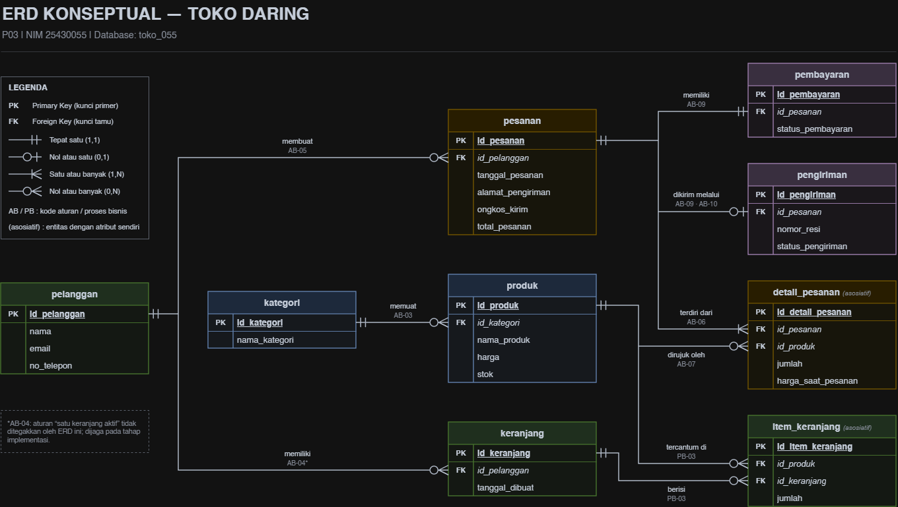

# Laporan Praktikum Basis Data — Pertemuan 3

- Nama: Raihan Ardani
- NIM: 25430055
- Kelas: C
- Mata Kuliah: Praktikum Basis Data
- Pertemuan: 1
- Dosen Pengampu: Dedi Irawan, S.Kom., M.T.I
- Tanggal: 14/10/2026

## 1. Tujuan Praktikum

Praktikum ini bertujuan untuk mengidentifikasi entitas, atribut, dan kunci dari dokumen kebutuhan data; menentukan relasi beserta kardinalitas dan partisipasinya berdasarkan aturan bisnis; memecah relasi banyak-ke-banyak menjadi entitas asosiatif; serta menggambar ERD dengan notasi Crow’s Foot dan memvalidasinya terhadap kebutuhan informasi (KI).

## 2. Ringkasan Dasar Teori

Entity-Relationship Diagram (ERD) adalah diagram untuk menggambarkan data yang disimpan dan hubungan antar-data. ERD konseptual berfokus pada entitas, atribut, kunci, relasi, dan kardinalitas, bukan pada tipe data atau DBMS tertentu.

- **Entitas:** objek atau kejadian yang datanya disimpan, misalnya pelanggan, produk, dan pesanan.
- **Atribut:** informasi yang menjelaskan entitas, misalnya nama pelanggan atau harga produk.
- **Primary Key (PK):** atribut yang membedakan setiap data secara unik.
- **Foreign Key (FK):** atribut yang menghubungkan suatu entitas dengan entitas lain.
- **Relasi:** hubungan bermakna antarentitas, biasanya dibaca sebagai kata kerja.
- **Kardinalitas dan partisipasi:** menjelaskan jumlah hubungan yang mungkin dan apakah hubungan itu wajib atau opsional.
- **Entitas asosiatif:** entitas yang menghubungkan dua entitas dalam relasi banyak-ke-banyak dan dapat memiliki atribut sendiri, misalnya jumlah produk dalam detail pesanan.
- **Crow’s Foot:** notasi yang menggunakan simbol garis, lingkaran, dan kaki gagak untuk menunjukkan satu, opsional, atau banyak.

Pada proyek Toko Daring, kode **AB** mengacu pada aturan bisnis, **PB** pada proses bisnis, dan **KI** pada kebutuhan informasi yang telah didokumentasikan pada P02.

## 3. Hasil Langkah Percobaan

### Menentukan entitas dan atribut

ERD proyek memuat sembilan entitas: `pelanggan`, `kategori`, `produk`, `keranjang`, `item_keranjang`, `pesanan`, `detail_pesanan`, `pembayaran`, dan `pengiriman`. Atribut dari dokumen P02 ditempatkan pada entitas yang sesuai. Setiap entitas memiliki PK, sedangkan atribut penghubung diberi label FK.

**Bukti:** 

## 4. Jawaban Titik Analisis

**Pertanyaan pada Modul 3:** Ketua ingin mengetahui “petugas gudang mana yang menerima barang dari pemasok”. Apakah ERD saat ini dapat menjawabnya? Jika belum, relasi apa yang perlu ditambahkan, dan apakah keputusan itu perlu dicatat sebagai aturan bisnis baru?

**Jawaban:**

ERD hanya dapat menjawab pertanyaan tersebut jika data penerimaan barang menghubungkan petugas gudang, pemasok, dan transaksi atau catatan penerimaan barang. Jika ERD belum memiliki hubungan itu, perlu ditambahkan entitas atau relasi penerimaan barang yang mencatat siapa pemasoknya, petugas yang menerima, dan barang yang diterima. Aturan bisnisnya juga perlu didokumentasikan, misalnya setiap penerimaan barang dicatat bersama petugas yang memprosesnya. Dengan begitu, kebutuhan informasi tersebut dapat diuji dan tidak hanya bergantung pada asumsi saat membuat diagram.

## 5. Hasil Latihan dan Modifikasi

### 5.1 Poin loyalitas anggota

Pada latihan modul, jika poin loyalitas hanya menunjukkan jumlah poin terkini, poin dapat menjadi atribut pada entitas anggota. Namun, jika sistem harus menyimpan riwayat penambahan dan penggunaan poin, lebih tepat membuat entitas riwayat poin yang mencatat tanggal, perubahan poin, dan keterangan transaksi. Entitas riwayat diperlukan agar perubahan poin dapat ditelusuri.

*Latihan ini menggunakan contoh Kopma dari modul; bukan bagian dari entitas proyek Toko Daring.*

### 5.2 Relasi penjualan–barang tanpa entitas asosiatif

Jika penjualan dan barang dihubungkan langsung sebagai relasi banyak-ke-banyak tanpa entitas asosiatif, data yang berkaitan dengan masing-masing barang di dalam transaksi menjadi sulit dicatat. Contohnya, jumlah barang dan harga satuan saat transaksi tidak memiliki tempat yang tepat untuk disimpan pada relasi tersebut. Karena itu, entitas `detail_penjualan` dibutuhkan dalam contoh Kopma.

*Latihan ini menggunakan contoh Kopma dari modul; pada proyek Toko Daring, konsep yang sepadan diterapkan melalui `detail_pesanan`.*

## 6. Tugas Mandiri: Milestone Proyek 3

### 6.1 Berkas ERD

- Berkas sumber: `p03_erd_25430055.drawio`
- Hasil ekspor: `p03_erd_25430055.png`
- Nama database proyek: `toko_055`

ERD dirancang dari dokumen kebutuhan data P02. Diagram mencantumkan entitas, atribut, PK/FK, relasi, kardinalitas Crow’s Foot, label hubungan, kode aturan/proses, dan legenda. `item_keranjang` serta `detail_pesanan` merupakan entitas asosiatif dengan atribut sendiri.

### 6.2 Tabel relasi dan kardinalitas

| No. | Relasi | Kardinalitas | Dasar | Penjelasan |
|---:|---|---|---|---|
| 1 | `kategori` — `produk` | Kategori 1 : Produk 0..N | AB-03 | Satu kategori dapat belum memiliki produk atau memiliki banyak produk; setiap produk terkait dengan satu kategori. |
| 2 | `pelanggan` — `keranjang` | Pelanggan 1 : Keranjang 0..N dalam riwayat | AB-04 | Keranjang dapat tercatat dari waktu ke waktu. Batas satu keranjang aktif harus ditegakkan pada implementasi. |
| 3 | `pelanggan` — `pesanan` | Pelanggan 1 : Pesanan 0..N | AB-05 | Pelanggan dapat membuat banyak pesanan; setiap pesanan dimiliki satu pelanggan. |
| 4 | `keranjang` — `item_keranjang` | Keranjang 1 : Item 0..N | PB-03 | Satu keranjang dapat berisi beberapa item. |
| 5 | `produk` — `item_keranjang` | Produk 1 : Item 0..N | PB-03 | Satu produk dapat muncul di banyak item keranjang. |
| 6 | `pesanan` — `detail_pesanan` | Pesanan 1 : Detail 1..N | AB-06 | Setiap pesanan harus memiliki minimal satu detail. |
| 7 | `produk` — `detail_pesanan` | Produk 1 : Detail 0..N | AB-07 | Setiap detail merujuk satu produk; produk dapat muncul pada banyak detail. |
| 8 | `pesanan` — `pembayaran` | Pesanan 1 : Pembayaran 1 | AB-09 | Setiap pesanan memiliki satu catatan pembayaran dalam ruang lingkup awal. |
| 9 | `pesanan` — `pengiriman` | Pesanan 1 : Pengiriman 0..1 | AB-09, AB-10 | Pesanan dapat belum memiliki catatan pengiriman atau memiliki satu catatan pengiriman. Pengiriman diproses setelah pembayaran dikonfirmasi. |

### 6.3 Pemetaan kebutuhan informasi ke jalur ERD

| Kode KI | Kebutuhan informasi | Jalur ERD |
|---|---|---|
| KI-01 | Melihat produk berdasarkan kategori | `kategori` → `produk` |
| KI-02 | Melihat isi keranjang dan jumlah produk | `pelanggan` → `keranjang` → `item_keranjang` → `produk` |
| KI-03 | Melihat riwayat pesanan pelanggan | `pelanggan` → `pesanan` |
| KI-04 | Melihat produk, jumlah, dan harga saat pembelian | `pesanan` → `detail_pesanan` → `produk` |
| KI-05 | Melihat status pembayaran dan pengiriman | `pesanan` → `pembayaran` dan `pesanan` → `pengiriman` |

Kelima kebutuhan informasi tersebut memiliki jalur penelusuran pada rancangan ERD.

### 6.4 Pemeriksaan standar kelengkapan

| Unsur | Pemeriksaan |
|---|---|
| Entitas | Sembilan entitas proyek tercantum dengan nama huruf kecil. |
| Atribut | Atribut dari dokumen P02 ditempatkan pada entitas terkait. |
| Kunci | PK dan FK diberi label. |
| Kardinalitas | Simbol Crow’s Foot dan keterangan jumlah dicantumkan. |
| Garis relasi | Relasi menghubungkan entitas berdasarkan kunci yang terkait dan diberi label. |
| Legenda | Legenda menerangkan PK, FK, kardinalitas, dan entitas asosiatif. |
| Entitas asosiatif | `item_keranjang` dan `detail_pesanan` memiliki atribut sendiri. |
| Validasi KI | KI-01 sampai KI-05 dapat ditelusuri. |

**Catatan desain:** ERD P03 adalah model konseptual. Tipe data SQL dan constraint rinci ditetapkan pada tahap implementasi/DDL Modul 5. Jika tipe seperti `INT` atau `VARCHAR` ditampilkan pada draft diagram, perlakukan sebagai usulan awal yang belum final.

### 6.5 Keputusan desain

1. `item_keranjang` mencatat produk dan jumlahnya dalam keranjang.
2. `detail_pesanan` menyimpan jumlah serta harga saat pemesanan agar riwayat transaksi tetap mencerminkan harga pada waktu transaksi.
3. `alamat_pengiriman` dan `ongkos_kirim` disimpan pada `pesanan` sesuai AB-08.
4. Batas satu keranjang aktif per pelanggan (AB-04) perlu ditangani pada implementasi karena ERD saja belum menjaminnya.
5. Aturan pengiriman setelah pembayaran dikonfirmasi (AB-10) perlu diterapkan dalam alur proses.
 
## 7. Pembahasan dan Kendala

ERD mengubah daftar kebutuhan data pada P02 menjadi diagram yang menunjukkan struktur data dan hubungan antarentitas. Entitas asosiatif diperlukan untuk menyimpan atribut yang berkaitan dengan hubungan produk dan transaksi. Jalur KI membantu memeriksa apakah rancangan dapat mendukung informasi yang dibutuhkan.

Aturan satu keranjang aktif (AB-04) dan pengiriman setelah pembayaran dikonfirmasi (AB-10) tidak cukup dijamin oleh diagram konseptual saja. Aturan tersebut perlu diperiksa dan ditegakkan saat implementasi.

**Kendala** yang benar-benar dialami: Memahami legenda, memahami penjelasan ERD 

**Cara mengatasi:** Melakukan pencarian lebih lanjut di youtube untuk memahami kendala di atas

## 8. Kesimpulan

ERD konseptual proyek Toko Daring dibuat berdasarkan kebutuhan data P02 dan mencakup sembilan entitas beserta atribut, PK/FK, relasi, serta kardinalitasnya. Entitas `item_keranjang` dan `detail_pesanan` membantu mencatat hubungan produk dengan keranjang dan pesanan, termasuk jumlah serta harga saat transaksi. Pemetaan menunjukkan KI-01 sampai KI-05 dapat ditelusuri melalui ERD, sedangkan beberapa aturan proses masih perlu ditegakkan pada tahap implementasi.

## 9. Pernyataan Penggunaan AI

AI digunakan sebagai alat bantu untuk menyusun kerangka laporan, merapikan penjelasan, dan memeriksa konsistensi istilah. memeriksa ERD dan isi laporan, memvalidasi kesesuaian dengan dokumen P02, serta melengkapi bukti yang benar-benar tersedia.

## 10. Bukti Git

- **Repositori:** https://github.com/raihanar575-cmd/basisdata-25430055
- **Pesan commit:** menambahkan desain konseptual ERD dan laporan praktikum
- **Hash commit:**
- **Bukti push:** https://github.com/raihanar575-cmd/basisdata-25430055/commits/main

## Checklist

Salin checklist resmi dari buku/modul dan beri tanda centang hanya pada pekerjaan yang benar-benar selesai.

- [x] ERD proyek tersedia sebagai berkas `.drawio` dan `.png`.
- [x] Tabel relasi dan kardinalitas disertai kode AB yang mendasari.
- [x] Semua KI proyek dipetakan ke jalur ERD.
- [x] Minimal satu entitas asosiatif memiliki atribut sendiri.
- [x] ERD memenuhi standar kelengkapan konseptual.
- [x] Minimal dua umpan balik teman sekelas dicatat beserta keputusan dan alasannya.
- [x] Pembahasan dan kendala diisi berdasarkan pekerjaan nyata.
- [x] Pernyataan penggunaan AI dicantumkan.
- [x] Tautan repositori dan hash commit P03 dicantumkan.
- [x] Screenshot/bukti memperlihatkan informasi yang diminta pada panduan praktikum.
