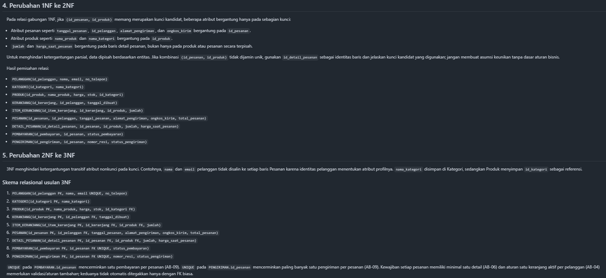

# Laporan Praktikum Basis Data — Pertemuan 4

- Nama: Raihan Ardani
- NIM: 25430055
- Kelas: C
- Mata Kuliah: Praktikum Basis Data
- Pertemuan: 1
- Dosen Pengampu: Dedi Irawan, S.Kom., M.T.I
- Tanggal: 21/10/2026

## 1. Tujuan Praktikum

Praktikum ini bertujuan mengenali anomali data, menentukan dependensi fungsional berdasarkan aturan bisnis, melakukan normalisasi hingga 3NF, memeriksa BCNF, dan mendokumentasikan skema relasional akhir proyek Toko Daring.

## 2. Ringkasan Dasar Teori

Normalisasi mengurangi pengulangan data dan mencegah anomali ubah, sisip, serta hapus. Proses dilakukan bertahap dari UNF ke 1NF, 2NF, dan 3NF. Dependensi fungsional harus diturunkan dari aturan bisnis, bukan hanya dari contoh data. Setelah 3NF, relasi diperiksa terhadap BCNF dengan memastikan setiap penentu merupakan kunci kandidat.

## 3. Hasil Langkah Percobaan

### 3.1 Relasi awal (UNF)

Dokumen kebutuhan data P02 Toko Daring digunakan sebagai sumber. Dalam bentuk UNF, satu pesanan secara konseptual dapat berisi grup berulang produk, jumlah, dan harga saat transaksi.

### 3.2 Tahapan normalisasi

Tahapan UNF → 1NF → 2NF → 3NF dan skema relasional proyek dicatat di `p04_normalisasi_25430055.md`.

**Bukti screenshot tahapan normalisasi:**

### 3.3 Dependensi fungsional dan BCNF

Dependensi fungsional disusun dari aturan bisnis P02. Daftar FD harus dicocokkan kembali dengan kode AB yang sesuai. Pemeriksaan BCNF dilakukan dengan memeriksa apakah setiap penentu FD merupakan kunci kandidat.

### 3.4 Keputusan nilai turunan

`harga_saat_pesanan` dipertahankan untuk menjaga harga historis transaksi. `subtotal` dapat dihitung dari jumlah dikalikan harga saat pesanan. Keputusan untuk `total_pesanan` harus dinyatakan secara eksplisit: disimpan sebagai snapshot transaksi atau dihitung dari detail dan ongkos kirim, disertai alasan.

## 4. Jawaban Titik Analisis

### Titik Analisis 1

`harga_saat_pesanan` bergantung pada detail transaksi, bukan hanya pada `id_produk`, karena harga produk dapat berubah. Jika harga historis diganti dengan harga produk saat ini, perhitungan transaksi lama dan laporan omzet masa lalu dapat menjadi tidak akurat.

### Titik Analisis 2

Pemisahan tabel membantu menghindari pengulangan fakta, tetapi tabel tidak perlu dipecah berlebihan. Setiap pemisahan harus didukung dependensi fungsional dan benar-benar mengurangi anomali.

### Titik Analisis 3

Pada contoh Kopma, informasi pemasok disimpan dalam relasi pembelian, bukan sebagai satu nama pemasok di tabel barang. Cara ini memungkinkan barang yang sama dibeli dari pemasok berbeda pada transaksi berbeda dan menjaga riwayat pembelian.

## 5. Hasil Latihan dan Modifikasi

### 5.1 Beberapa nomor telepon untuk pemasok

Jika satu pemasok dapat memiliki beberapa nomor telepon, nomor tidak disimpan sebagai daftar dalam satu sel. Gunakan relasi terpisah, misalnya `TELEPON_PEMASOK(id_pemasok, nomor_telepon)`, dengan kunci yang sesuai aturan bisnis.

### 5.2 Anomali ubah nama anggota

Jika `nama_anggota` disimpan berulang di tabel penjualan, perubahan nama harus dilakukan pada banyak baris. Jika ada baris yang tidak diperbarui, data menjadi tidak konsisten. Solusinya adalah menyimpan nama anggota di tabel anggota dan mereferensikannya dari penjualan melalui ID anggota.

## 6. Tugas Mandiri: Milestone Proyek 4

Dokumen proyek disimpan sebagai `p04_normalisasi_25430055.md`. Isinya mencakup relasi UNF, tahapan 1NF sampai 3NF, daftar FD yang dikaitkan dengan aturan bisnis, pemeriksaan BCNF, keputusan nilai turunan, dan catatan perubahan ERD bila ada.

Sebelum dikumpulkan, saya perlu memverifikasi kesesuaian seluruh FD dengan aturan bisnis P02, hasil akhir pemeriksaan BCNF, dan keputusan final untuk `total_pesanan`.

## 7. Pembahasan dan Kendala

Kendala yang mungkin muncul adalah menentukan dependensi fungsional yang benar dan membedakan nilai yang disimpan dengan nilai yang dapat dihitung. Untuk mengatasinya, atribut dicocokkan dengan aturan bisnis dan setiap pemisahan diperiksa apakah benar-benar mengurangi pengulangan data serta anomali.

> Sesuaikan bagian ini dengan kendala yang benar-benar dialami.

## 8. Kesimpulan

Normalisasi membantu menyusun data Toko Daring ke dalam relasi yang lebih teratur dan mengurangi pengulangan fakta. Skema hasil normalisasi menjadi dasar pembuatan DDL pada P05. Dependensi fungsional, BCNF, dan keputusan nilai turunan perlu diverifikasi kembali sebelum laporan dikumpulkan.

## 9. Pernyataan Penggunaan AI

AI digunakan untuk membantu memahami konsep normalisasi, menyusun kerangka dokumentasi, dan memeriksa konsistensi awal. Dependensi fungsional, keputusan desain, hasil akhir normalisasi, dan bukti praktikum diperiksa kembali berdasarkan aturan bisnis proyek dan pekerjaan yang benar-benar dilakukan.

## 10. Bukti Git

- Repositori: https://github.com/raihanar575-cmd/basisdata-25430055
- Pesan commit: P04-Menambahkan Analisis Normalisasi dan Laporan

## Checklist Pengumpulan

- [x] `p04_normalisasi_25430055.md` sudah diperiksa dan dilengkapi.
- [x] Screenshot tahapan UNF → 1NF → 2NF → 3NF sudah ditambahkan.
- [x] FD dikaitkan dengan kode AB yang benar.
- [x] Keputusan nilai turunan dan pemeriksaan BCNF sudah diverifikasi.
- [x] Laporan P04 sudah dilengkapi.
- [x] Kedua file dan gambar terkait sudah di-commit dan di-push.
