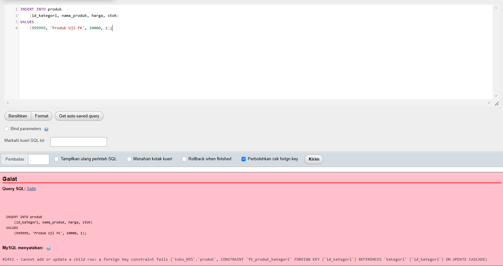
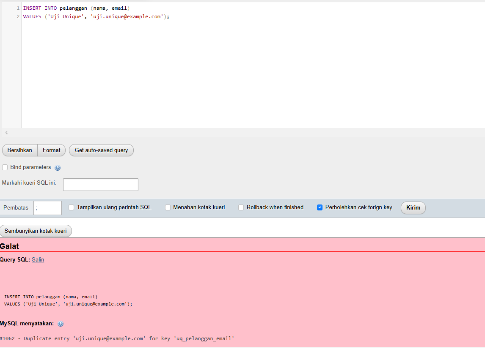
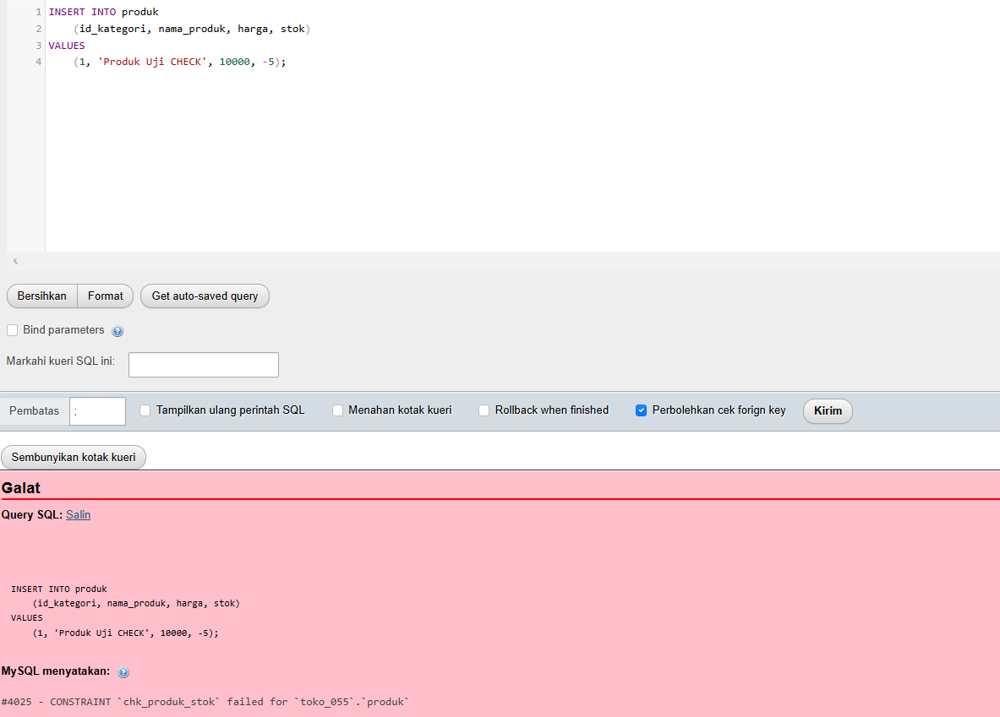
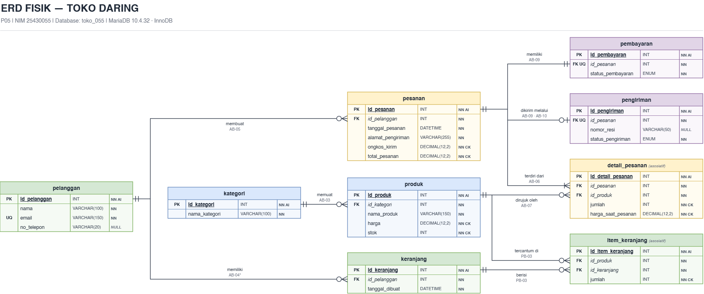

# Laporan Praktikum Basis Data - Pertemuan 5

- Nama: Raihan Ardani
- NIM: 25430055
- Kelas: C
- Mata Kuliah: Praktikum Basis Data
- Pertemuan: 5
- Dosen Pengampu: Dedi Irawan, S.Kom., M.T.I
- Tanggal: 28/10/2026


## 1. Tujuan Praktikum

1. Menerapkan rancangan relasional proyek Toko Daring menjadi tabel fisik menggunakan Data Definition Language (DDL).
2. Menentukan tipe data dan constraint yang sesuai untuk atribut pada setiap tabel.
3. Membuat ERD fisik yang konsisten dengan skrip SQL DDL.
4. Menguji constraint agar dapat diketahui apakah data yang melanggar aturan bisnis ditolak oleh MariaDB.
5. Mendokumentasikan hasil praktik dan pekerjaan proyek melalui laporan serta Git.

## 2. Ringkasan Dasar Teori

Data Definition Language (DDL) digunakan untuk membuat dan mengubah struktur basis data melalui perintah seperti `CREATE TABLE`, `ALTER TABLE`, dan `DROP TABLE`. Primary key (PK) membedakan setiap baris secara unik, sedangkan foreign key (FK) menjaga integritas hubungan antartabel. Constraint `NOT NULL`, `UNIQUE`, dan `CHECK` membatasi data yang dapat disimpan.

ERD fisik menjelaskan struktur implementasi tabel, termasuk nama kolom, tipe data, nullability, PK/FK, dan constraint. Karena itu, diagram fisik harus sesuai dengan DDL yang dijalankan. Skrip yang dapat dijalankan ulang perlu menghapus tabel anak sebelum tabel induknya agar ketergantungan foreign key tidak menghalangi penghapusan tabel.

## 3. Hasil Langkah Percobaan

### 3.1 Menyiapkan dan menjalankan DDL

Berkas DDL proyek bernama `p05_ddl_25430055.sql`. Database yang digunakan adalah `toko_055` dengan target DBMS MariaDB 10.4.32 dan storage engine InnoDB.

ERD fisik terbaru memuat sembilan tabel: `pelanggan`, `kategori`, `produk`, `keranjang`, `item_keranjang`, `pesanan`, `detail_pesanan`, `pembayaran`, dan `pengiriman`. Skrip DDL perlu membuat tabel-tabel tersebut dengan urutan yang sesuai ketergantungan FK serta dapat dijalankan ulang dari kondisi tabel proyek kosong. Skrip tidak menggunakan `DROP DATABASE`.

**Hasil eksekusi DDL:** [isi apakah skrip berhasil, jumlah tabel yang terbentuk, dan pesan yang benar-benar muncul].

**Gambar 1. Eksekusi DDL proyek.** Simpan screenshot di `laporan/img/p05_ddl_berhasil.png`.

### 3.2 Memeriksa struktur tabel

Struktur tabel diperiksa dengan `SHOW CREATE TABLE` untuk memastikan definisi SQL cocok dengan ERD. Contoh perintah:

```sql
SHOW CREATE TABLE produk;
SHOW CREATE TABLE pesanan;
```

Periksa nama kolom, tipe data, PK, FK, nullability, UNIQUE, CHECK, DEFAULT, nilai ENUM, dan aksi referensial jika digunakan.

**Gambar 2. Hasil SHOW CREATE TABLE.** !

[Hasil SHOW CREATE TABLE](img/p05_show_create_table.png)

### 3.3 Menguji constraint

Pengujian dilakukan dengan masukan yang sengaja melanggar constraint. Sesuaikan query dengan nama kolom serta definisi pada DDL final. Setiap screenshot harus memperlihatkan query dan hasil atau pesan galat MariaDB.

| Pengujian | Perilaku yang diharapkan | Hasil nyata |
|---|---|---|
| Foreign key | Nilai FK yang tidak memiliki pasangan pada tabel induk ditolak | Diharapkan ditolak dengan ERROR 1452 karena melanggar constraint foreign key. |
| UNIQUE email | Email pelanggan yang sama tidak dapat ditambahkan untuk kedua kalinya | Diharapkan ditolak dengan ERROR 1062 karena terjadi duplikasi nilai email yang bersifat UNIQUE. |
| CHECK | Nilai yang melanggar ekspresi CHECK, misalnya stok negatif apabila dilarang, ditolak | Diharapkan ditolak dengan ERROR 4025 karena kondisi CHECK tidak terpenuhi. |

**Gambar 3. Pengujian FK.**



**Gambar 4. Pengujian UNIQUE.** 



**Gambar 5. Pengujian CHECK.** 




### 3.4 ERD fisik yang dibuat

ERD fisik disusun berdasarkan ERD konseptual P03. Diagram versi terbaru menampilkan sembilan tabel, tipe data dasar, PK, FK, atribut nullable, UNIQUE pada `pelanggan.email`, UNIQUE pada `pembayaran.id_pesanan` dan `pengiriman.id_pesanan`, serta penanda CHECK untuk kolom tertentu.

Berkas dokumentasi yang digunakan:

- `p05_erd_fisik_25430055.drawio` — sumber diagram yang dapat diedit.
- `p05_erd_fisik_25430055.png` — ekspor gambar diagram.

**Gambar 6. ERD fisik Toko Daring.** Simpan gambar final di `laporan/img/p05_erd_fisik_25430055.png` dan tampilkan menggunakan:




## 4. Jawaban Titik Analisis

### 4.1 Mengapa tabel induk dibuat sebelum tabel anak?

Tabel anak dapat memiliki FK yang merujuk ke PK atau kolom unik pada tabel induk. Oleh karena itu, tabel induk harus tersedia ketika FK dibuat. Tipe data kolom yang dihubungkan juga harus kompatibel. Jika definisi FK tidak sesuai, MariaDB dapat menolak pembuatan constraint, misalnya melalui `ERROR 1005` dengan `errno: 150`.

### 4.2 Apa arti kegagalan saat FK, UNIQUE, atau CHECK dilanggar?

- **FK:** nilai FK tidak memiliki pasangan pada tabel induk, atau penghapusan/perubahan data induk bertentangan dengan baris anak yang masih merujuknya.
- **UNIQUE:** nilai yang seharusnya unik sudah digunakan baris lain, misalnya email pelanggan yang duplikat.
- **CHECK:** nilai tidak memenuhi ekspresi yang ditentukan, misalnya `stok < 0` apabila DDL menerapkan `CHECK (stok >= 0)`.

Kode galat serta hasil sebenarnya perlu dicatat dari pengujian MariaDB. Pemetaan constraint pada proyek harus merujuk aturan bisnis P02 milik Toko Daring, bukan kode aturan bisnis dari contoh Kopma.

### 4.3 Mengapa tabel anak dihapus lebih dahulu daripada tabel induk?

Tabel anak bergantung pada tabel induk melalui FK. Jika tabel induk dihapus saat masih direferensikan, MariaDB dapat menolak penghapusan. Oleh karena itu, `DROP TABLE IF EXISTS` disusun dari tabel anak ke tabel induk. Setelah dependensi anak dihapus, tabel induk dapat dihapus dalam proses pembangunan ulang skema.

### 4.4 Bagaimana menerapkan parameter P + 2 = 4?

Untuk NIM `25430055`, nilai `P = 2`, sehingga `P + 2 = 4`. Penerapan batas ini harus mengikuti definisi pada modul praktikum. Jika yang dibatasi adalah jumlah baris detail dalam satu pesanan, `CHECK (jumlah <= 4)` bukan implementasi yang setara karena hanya membatasi nilai `jumlah` pada satu baris, bukan menghitung seluruh baris detail untuk pesanan tersebut. Batas lintas baris membutuhkan mekanisme tambahan yang sesuai dan harus dijelaskan secara terpisah.

### 4.5 Aturan bisnis yang belum sepenuhnya ditegakkan oleh constraint sederhana

- **AB-04 — satu keranjang aktif per pelanggan:** gambar saat ini menghubungkan `pelanggan` dengan `keranjang`, tetapi tidak menampilkan kolom status aktif. FK saja tidak menjamin hanya ada satu keranjang aktif. Jika aturan harus ditegakkan, diperlukan perubahan desain dan mekanisme tambahan yang dijelaskan dalam ERD serta DDL.
- **AB-06 — setiap pesanan mempunyai minimal satu detail:** relasi FK dari `detail_pesanan` ke `pesanan` memastikan detail merujuk pesanan yang ada, tetapi tidak menjamin setiap pesanan pasti memiliki detail. Validasi transaksi atau mekanisme tambahan diperlukan.
- **AB-10 — pengiriman setelah pembayaran dikonfirmasi:** FK saja tidak memeriksa status pembayaran pada tabel lain. Aturan ini memerlukan validasi proses atau mekanisme tambahan yang dirancang serta diuji.

## 5. Hasil Latihan dan Modifikasi

Latihan pada langkah percobaan menggunakan skema contoh Kopma. Hasilnya harus didokumentasikan terpisah dari proyek Toko Daring.

### 5.1 Mengubah aksi FK menjadi ON DELETE SET NULL

Instruksi latihan meminta perubahan `fk_penjualan_anggota` menjadi `ON DELETE SET NULL`. Kolom FK harus mengizinkan NULL agar tindakan tersebut dapat diterapkan. Analisis juga perlu menilai konsistensinya dengan aturan bisnis latihan dan prinsip minimisasi data pribadi.

**Perintah SQL:** 

```sql
ALTER TABLE penjualan
DROP FOREIGN KEY fk_penjualan_anggota;

ALTER TABLE penjualan
ADD CONSTRAINT fk_penjualan_anggota
FOREIGN KEY (id_anggota)
REFERENCES anggota (id_anggota)
ON DELETE SET NULL;
```

**Hasil MariaDB:**
Jika kedua perintah berhasil dijalankan, constraint fk_penjualan_anggota akan diperbarui dengan aksi ON DELETE SET NULL. MariaDB seharusnya menampilkan pesan keberhasilan seperti Query OK. Ketika data anggota yang dirujuk dihapus, nilai id_anggota pada transaksi terkait akan diubah menjadi NULL, sedangkan data penjualannya tetap tersimpan.

**Analisis:**
Perubahan ini sesuai sebagian dengan AB-02, yang menyatakan bahwa penjualan boleh dilakukan tanpa anggota. Ketika anggota dihapus, transaksi tetap tersimpan dan dapat diperlakukan sebagai transaksi tanpa anggota karena id_anggota menjadi NULL. Namun, perubahan tersebut juga menghilangkan hubungan antara transaksi lama dan anggota yang sebelumnya tercatat. Akibatnya, riwayat belanja anggota dan pelacakan transaksi dapat menjadi kurang lengkap.

Dari sudut pandang Undang-Undang Pelindungan Data Pribadi (UU PDP), tindakan ini dapat membantu mengurangi keterkaitan data transaksi dengan identitas anggota. Akan tetapi, ON DELETE SET NULL tidak otomatis menghapus seluruh data pribadi yang mungkin tersimpan di tabel lain. Pengelolaan data tetap perlu mempertimbangkan tujuan pemrosesan, kebutuhan penyimpanan catatan transaksi, dan perlindungan data pribadi.

Dengan demikian, ON DELETE SET NULL dapat digunakan ketika penghapusan hubungan dengan anggota memang diperlukan, tetapi perlu dipertimbangkan dampaknya terhadap riwayat transaksi dan kebutuhan audit.

Perubahan ini merupakan latihan pada skema Kopma, bukan perubahan otomatis untuk skema Toko Daring.

## 6. Tugas Mandiri — Milestone Proyek 5

### 6.1 Pemetaan tipe data berdasarkan ERD fisik terbaru

Tabel berikut merangkum struktur yang tampak pada diagram. Detail akhir—termasuk nilai ENUM, ekspresi CHECK, DEFAULT, dan aksi referensial—harus disamakan dengan DDL yang benar-benar digunakan.

| Tabel | Kolom | Tipe data pada ERD | Constraint/keterangan yang terlihat |
|---|---|---|---|
| `pelanggan` | `id_pelanggan` | `INT` | PK, NN, AI |
| `pelanggan` | `nama` | `VARCHAR(100)` | NN |
| `pelanggan` | `email` | `VARCHAR(150)` | NN, UQ; AB-02 |
| `pelanggan` | `no_telepon` | `VARCHAR(20)` | NULL; data pribadi perlu ditandai |
| `kategori` | `id_kategori` | `INT` | PK, NN, AI |
| `kategori` | `nama_kategori` | `VARCHAR(100)` | NN |
| `produk` | `id_produk` | `INT` | PK, NN, AI |
| `produk` | `id_kategori` | `INT` | FK, NN → `kategori.id_kategori`; AB-03 |
| `produk` | `nama_produk` | `VARCHAR(150)` | NN |
| `produk` | `harga` | `DECIMAL(12,2)` | NN, CK; ekspresi perlu dicantumkan |
| `produk` | `stok` | `INT` | NN, CK; ekspresi perlu dicantumkan |
| `keranjang` | `id_keranjang` | `INT` | PK, NN, AI |
| `keranjang` | `id_pelanggan` | `INT` | FK, NN → `pelanggan.id_pelanggan`; AB-04 |
| `keranjang` | `tanggal_dibuat` | `DATETIME` | NN |
| `item_keranjang` | `id_item_keranjang` | `INT` | PK, NN, AI |
| `item_keranjang` | `id_produk` | `INT` | FK, NN → `produk.id_produk` |
| `item_keranjang` | `id_keranjang` | `INT` | FK, NN → `keranjang.id_keranjang` |
| `item_keranjang` | `jumlah` | `INT` | NN, CK; ekspresi perlu dicantumkan |
| `pesanan` | `id_pesanan` | `INT` | PK, NN, AI |
| `pesanan` | `id_pelanggan` | `INT` | FK, NN → `pelanggan.id_pelanggan`; AB-05 |
| `pesanan` | `tanggal_pesanan` | `DATETIME` | NN |
| `pesanan` | `alamat_pengiriman` | `VARCHAR(255)` | NN; AB-08 |
| `pesanan` | `ongkos_kirim` | `DECIMAL(12,2)` | NN, CK; AB-08 |
| `pesanan` | `total_pesanan` | `DECIMAL(12,2)` | NN, CK; keputusan simpan/hitung mengikuti P04 |
| `detail_pesanan` | `id_detail_pesanan` | `INT` | PK, NN, AI |
| `detail_pesanan` | `id_pesanan` | `INT` | FK, NN → `pesanan.id_pesanan`; AB-06 |
| `detail_pesanan` | `id_produk` | `INT` | FK, NN → `produk.id_produk`; AB-07 |
| `detail_pesanan` | `jumlah` | `INT` | NN, CK |
| `detail_pesanan` | `harga_saat_pesanan` | `DECIMAL(12,2)` | NN, CK; AB-07 |
| `pembayaran` | `id_pembayaran` | `INT` | PK, NN, AI |
| `pembayaran` | `id_pesanan` | `INT` | FK, UQ, NN → `pesanan.id_pesanan`; AB-09 |
| `pembayaran` | `status_pembayaran` | `ENUM` | NN; nilai ENUM belum dicantumkan pada diagram |
| `pengiriman` | `id_pengiriman` | `INT` | PK, NN, AI |
| `pengiriman` | `id_pesanan` | `INT` | FK, UQ, NN → `pesanan.id_pesanan`; AB-09 |
| `pengiriman` | `nomor_resi` | `VARCHAR(50)` | NULL |
| `pengiriman` | `status_pengiriman` | `ENUM` | NN; nilai ENUM belum dicantumkan pada diagram |

### 6.2 Pemetaan aturan bisnis ke implementasi

| Aturan | Rancangan implementasi | Batasan/catatan |
|---|---|---|
| AB-01 — ID pelanggan unik | PK pada `pelanggan.id_pelanggan` | PK unik dan tidak NULL |
| AB-02 — email pelanggan unik | UNIQUE pada `pelanggan.email` | Harus diuji menggunakan email duplikat |
| AB-03 — setiap produk mempunyai kategori | FK `produk.id_kategori` ke `kategori.id_kategori`, kolom NN | Menolak kategori yang tidak ada |
| AB-04 — satu keranjang aktif per pelanggan | Belum ditegakkan oleh struktur yang terlihat pada diagram | Perlu status aktif serta mekanisme tambahan jika wajib ditegakkan |
| AB-05 — pesanan dimiliki pelanggan | FK `pesanan.id_pelanggan` | Kolom NN pada diagram |
| AB-06 — minimal satu detail per pesanan | Relasi `pesanan`–`detail_pesanan` | FK biasa tidak cukup untuk menjamin minimal satu baris detail |
| AB-07 — harga dan jumlah saat transaksi disimpan | Kolom `jumlah` dan `harga_saat_pesanan` di `detail_pesanan` | Harga historis tidak boleh digantikan oleh harga produk terkini |
| AB-08 — alamat dan ongkos kirim disimpan | `alamat_pengiriman`, `ongkos_kirim` di `pesanan` | CHECK ongkos kirim harus punya ekspresi lengkap di DDL/ERD |
| AB-09 — satu pembayaran dan maksimal satu pengiriman | FK serta UQ pada `id_pesanan` di `pembayaran` dan `pengiriman` | Pengiriman opsional sesuai kardinalitas ERD |
| AB-10 — pengiriman setelah pembayaran terkonfirmasi | Belum ditegakkan oleh relasi FK saja | Perlu validasi proses atau mekanisme tambahan dan pengujian |

### 6.3 Nama constraint

Nama constraint pada SQL harus mengikuti standar modul: `pk_`, `fk_`, `uq_`, dan `ck_` dengan nama yang deskriptif. Contohnya `pk_pelanggan`, `fk_produk_kategori`, `uq_pelanggan_email`, dan `ck_produk_stok_nonnegatif`. Komentar SQL harus mengaitkan constraint dengan kode AB yang tepat dari dokumen kebutuhan P02.

Pada ERD yang terlihat saat ini, ekspresi lengkap CHECK dan nama constraint belum ditampilkan; informasi tersebut perlu ditambahkan atau dipetakan secara jelas ke DDL final. Hal yang sama berlaku untuk daftar nilai ENUM, DEFAULT, dan tindakan ON DELETE/ON UPDATE jika digunakan.

### 6.4 Perbandingan ERD dan DDL

Perbandingan akhir dilakukan setelah DDL dijalankan. Cocokkan semua tabel, kolom, tipe data, nullability, PK, FK, UNIQUE, CHECK, ENUM, DEFAULT, dan aksi referensial. Catat perbedaan yang benar-benar ditemukan.

## 7. Pembahasan dan Kendala

ERD fisik terbaru telah memperlihatkan sembilan tabel, tipe data dasar, PK, FK, nullability, UNIQUE pada email, serta UNIQUE pada `id_pesanan` di tabel pembayaran dan pengiriman. Diagram juga menandai sejumlah kolom dengan CHECK. Agar siap final, ekspresi CHECK perlu dicantumkan, nilai ENUM harus dijabarkan, dan detail DEFAULT serta aksi referensial harus disamakan dengan DDL. Aturan AB-04, AB-06, dan AB-10 tidak boleh dianggap otomatis ditegakkan hanya karena relasi digambar.

**Kendala yang ditemukan:** Kendala yang ditemukan: Pengujian DDL dan constraint pada database toko_055 belum dilakukan secara menyeluruh di MariaDB, sehingga belum ada pesan galat aktual yang dapat dicatat. Kendala yang perlu diperhatikan adalah kemungkinan ketidaksesuaian tipe data pada foreign key, pelanggaran constraint UNIQUE akibat data duplikat, serta penolakan data yang tidak memenuhi CHECK. Perbaikan akan dilakukan berdasarkan pesan galat yang muncul ketika skrip SQL dijalankan dan diuji.

## 8. Kesimpulan

Pertemuan 5 berfokus pada implementasi rancangan relasional menjadi tabel fisik dengan DDL, penerapan constraint untuk menjaga integritas data, dan dokumentasi melalui ERD fisik. Pada proyek Toko Daring, keberhasilan milestone perlu dibuktikan dengan skrip yang dapat dijalankan ulang, kesesuaian diagram dengan definisi tabel di MariaDB, serta pengujian FK, UNIQUE, dan CHECK. Kesimpulan final perlu diperbarui berdasarkan hasil praktik dan bukan hanya rancangan awal.

## 9. Pernyataan Penggunaan AI

AI digunakan sebagai alat bantu dalam menyusun kerangka laporan, merapikan penjelasan teori, dan memetakan struktur ERD ke tabel serta constraint awal. Praktikan bertanggung jawab memeriksa kesesuaian desain dengan kebutuhan P02–P04, menjalankan SQL, membaca pesan galat, mengambil screenshot, dan memastikan isi laporan sesuai hasil praktik nyata.

## 10. Bukti Git

**Repositori:** https://github.com/raihanar575-cmd/basisdata-25430055  
**Berkas laporan:** `laporan/p05_laporan_25430055.md`  
**Pesan commit yang disarankan:** `P05 - Menambahkan DDL dan laporan erd fisik`  

## Checklist Pengumpulan

- [x] `p05_ddl_25430055.sql` dapat dijalankan ulang dari kondisi tabel kosong.
- [x] ERD fisik tersedia dalam format sumber `.drawio` dan PNG.
- [x] Tangkapan layar `SHOW CREATE TABLE` tabel utama sudah ditambahkan.
- [x] Bukti penolakan constraint FK sudah ditambahkan.
- [x] Bukti penolakan constraint UNIQUE sudah ditambahkan.
- [x] Bukti penolakan constraint CHECK sudah ditambahkan.
- [x] Alasan pemilihan tipe data dan constraint dijelaskan.
- [x] Constraint dipetakan ke AB-xx yang sesuai dengan dokumen P02.
- [x] Nama constraint mengikuti pola `pk_`, `fk_`, `uq_`, dan `ck_` ditambah nama tabel.
