# Laporan Praktikum Basis Data - Pertemuan 06

- Nama: Raihan Ardani
- NIM: 25430055
- Kelas: C
- Mata Kuliah: Praktikum Basis Data
- Pertemuan: 6
- Dosen Pengampu: Dedi Irawan, S.Kom., M.T.I
- Tanggal: 4/11/2026

## 1. Tujuan Praktikum

1. Mempraktikkan pengelolaan data menggunakan perintah Data Manipulation Language (DML).
2. Memasukkan data sampel ke dalam tabel yang saling berelasi dengan memperhatikan primary key dan foreign key.
3. Memeriksa jumlah dan konsistensi data yang telah dimasukkan.
4. Melakukan pengujian positif dan negatif terhadap constraint pada database.
5. Mendokumentasikan hasil pengujian dan batasan aturan bisnis yang belum dapat ditegakkan oleh struktur database.

## 2. Ringkasan Dasar Teori

Data Manipulation Language (DML) merupakan bagian dari SQL yang digunakan untuk mengelola isi tabel. Perintah `INSERT` digunakan untuk menambahkan baris, `UPDATE` untuk mengubah data, `DELETE` untuk menghapus data, dan `SELECT` untuk mengambil atau memeriksa data.

Pada basis data relasional, tabel dapat saling terhubung menggunakan primary key dan foreign key. Oleh karena itu, pengisian data perlu memperhatikan urutan hubungan antartabel. Data pada tabel induk harus tersedia sebelum data pada tabel anak yang merujuk kepadanya dimasukkan. Untuk penghapusan, baris pada tabel anak umumnya dihapus terlebih dahulu agar tidak melanggar referential integrity.

Pengujian basis data dilakukan untuk memastikan operasi dan constraint bekerja sesuai rancangan. Pengujian positif menggunakan data yang memenuhi aturan dan diharapkan berhasil. Pengujian negatif menggunakan data yang melanggar aturan dan diharapkan ditolak oleh DBMS. Hasil pengujian perlu dicatat berdasarkan keluaran aktual MariaDB, bukan hanya berdasarkan hasil yang diharapkan.

## 3. Hasil Langkah Percobaan

### 3.1 Menyiapkan dan menjalankan data sampel

Database yang digunakan dalam praktikum ini adalah `toko_055`, yaitu database proyek Toko Daring yang telah dibuat pada pertemuan sebelumnya. Struktur tabel mengikuti DDL dan ERD fisik P05.

Data sampel dimasukkan menggunakan skrip `p06_data_25430055.sql`. Skrip tersebut mengisi sembilan tabel proyek, yaitu `pelanggan`, `kategori`, `produk`, `keranjang`, `item_keranjang`, `pesanan`, `detail_pesanan`, `pembayaran`, dan `pengiriman`.

Urutan pengisian mengikuti hubungan foreign key. Tabel induk seperti `pelanggan` dan `kategori` diisi sebelum tabel yang bergantung kepadanya. Setelah itu data produk, keranjang, pesanan, detail pesanan, pembayaran, dan pengiriman dimasukkan.

### 3.2 Memeriksa jumlah baris setiap tabel

Setelah proses pengisian data, dilakukan pemeriksaan untuk memastikan data berhasil dimasukkan ke seluruh tabel. Pemeriksaan menggunakan fungsi agregat `COUNT(*)`, yang menghitung jumlah baris pada masing-masing tabel.

Query yang digunakan:

```sql
SELECT 'pelanggan' AS tabel, COUNT(*) AS jumlah FROM pelanggan
UNION ALL SELECT 'kategori', COUNT(*) FROM kategori
UNION ALL SELECT 'produk', COUNT(*) FROM produk
UNION ALL SELECT 'keranjang', COUNT(*) FROM keranjang
UNION ALL SELECT 'item_keranjang', COUNT(*) FROM item_keranjang
UNION ALL SELECT 'pesanan', COUNT(*) FROM pesanan
UNION ALL SELECT 'detail_pesanan', COUNT(*) FROM detail_pesanan
UNION ALL SELECT 'pembayaran', COUNT(*) FROM pembayaran
UNION ALL SELECT 'pengiriman', COUNT(*) FROM pengiriman;
```

Berdasarkan screenshot hasil pemeriksaan yang diperoleh, jumlah data pada setiap tabel adalah sebagai berikut.

| Tabel | Jumlah baris |
|---|---:|
| `pelanggan` | 5 |
| `kategori` | 5 |
| `produk` | 10 |
| `keranjang` | 5 |
| `item_keranjang` | 10 |
| `pesanan` | 20 |
| `detail_pesanan` | 20 |
| `pembayaran` | 20 |
| `pengiriman` | 15 |

**Gambar 3.3. Hasil pemeriksaan jumlah baris sembilan tabel.**

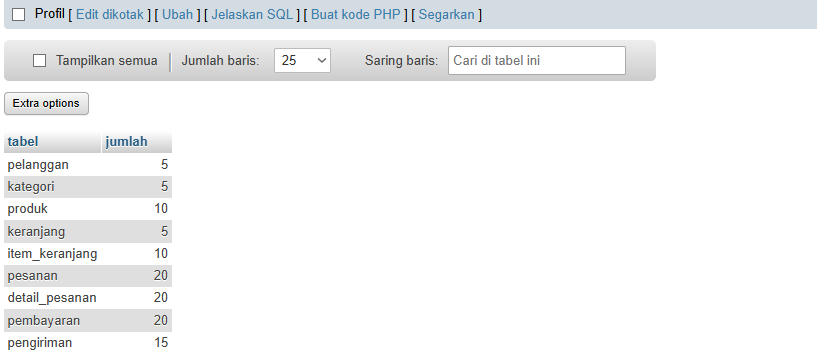

Hasil tersebut menunjukkan bahwa sembilan tabel telah terisi dan jumlah barisnya sesuai dengan target data sampel yang disiapkan. Tabel `pesanan` berisi 20 baris, sehingga target 20 transaksi utama telah tercapai.

### 3.3 Memeriksa sebaran tanggal transaksi

Selain memeriksa jumlah baris, tanggal transaksi juga diperiksa untuk memastikan pesanan tidak hanya tercatat pada satu tanggal. Pemeriksaan dilakukan dengan mengelompokkan data berdasarkan bagian tanggal dari kolom `tanggal_pesanan`.

Query yang digunakan:

```sql
SELECT DATE(tanggal_pesanan) AS tanggal,
       COUNT(*) AS jumlah_pesanan
FROM pesanan
GROUP BY DATE(tanggal_pesanan)
ORDER BY tanggal;
```

Data sampel P06 dirancang pada empat tanggal, yaitu 4, 5, 6, dan 7 Oktober 2026. Hasil aktual pemeriksaan perlu dicocokkan dengan keluaran query pada MariaDB.

**Gambar 3.3. Hasil pemeriksaan jumlah pesanan berdasarkan tanggal.**

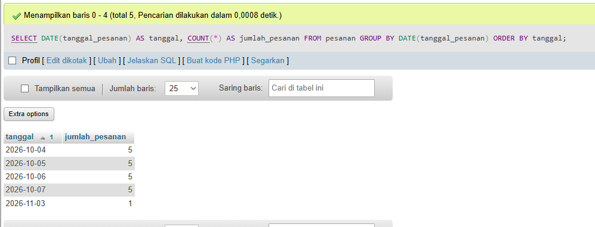

Hasil pemeriksaan ini digunakan sebagai bukti bahwa data transaksi tersebar pada lebih dari tiga tanggal. Screenshot keluaran query perlu dilampirkan agar sebaran tanggal dapat diverifikasi.

### 3.4 Melakukan pengujian skenario

Setelah data sampel tersedia, database diuji menggunakan skenario yang tercantum pada dokumen `p06_uji_25430055.md`. Pengujian dibagi menjadi pengujian positif dan negatif.

Pengujian positif memeriksa apakah data yang memenuhi ketentuan dapat disimpan. Pengujian negatif memeriksa apakah database menolak data yang melanggar constraint, seperti email duplikat, foreign key yang tidak memiliki pasangan, nilai yang melanggar CHECK, dan relasi yang dibatasi UNIQUE.

Setiap query dijalankan secara terpisah melalui tab SQL phpMyAdmin agar hasil setiap pengujian dapat diamati dan dicatat. Hasil aktual, termasuk pesan kesalahan MariaDB, dicatat pada dokumen skenario pengujian.


## 4. Jawaban Titik Analisis

### 4.1 Mengapa pengisian data harus memperhatikan urutan tabel?

Pengisian data harus memperhatikan hubungan primary key dan foreign key. Jika suatu tabel memiliki foreign key yang merujuk ke tabel lain, nilai yang dirujuk harus sudah tersedia pada tabel induk. Oleh karena itu, tabel induk diisi terlebih dahulu, kemudian tabel anak. Urutan ini mencegah pelanggaran referential integrity.

### 4.2 Apa fungsi primary key dan foreign key saat proses pengisian data?

Primary key berfungsi mengidentifikasi setiap baris secara unik dan mencegah adanya nilai kunci utama yang sama. Foreign key menghubungkan baris pada tabel anak dengan baris pada tabel induk serta menjaga agar nilai referensi tetap valid. Ketika data yang dimasukkan melanggar ketentuan tersebut, MariaDB dapat menolak operasi.

### 4.3 Apa perbedaan pengujian positif dan pengujian negatif?

Pengujian positif menggunakan data yang memenuhi ketentuan database. Operasi diharapkan berhasil, misalnya menambahkan pelanggan dengan alamat email yang belum digunakan. Pengujian negatif menggunakan data yang melanggar ketentuan, misalnya memasukkan email yang sudah ada atau menggunakan foreign key yang tidak memiliki pasangan. Operasi diharapkan ditolak oleh constraint terkait.

### 4.4 Mengapa hasil pengujian harus mencatat hasil aktual?

Hasil yang diharapkan merupakan perkiraan perilaku sistem berdasarkan rancangan, sedangkan hasil aktual merupakan keluaran yang benar-benar diberikan MariaDB. Keduanya perlu dibandingkan untuk mengetahui apakah constraint bekerja sesuai rancangan. Jika hasil aktual berbeda dari harapan, perbedaan tersebut perlu dianalisis dan dicatat sebagai temuan.

### 4.5 Apakah semua aturan bisnis dapat ditegakkan menggunakan CHECK atau foreign key?

Tidak. CHECK umumnya memeriksa nilai pada baris yang sedang dimasukkan atau diubah, sedangkan foreign key menjaga keberadaan referensi ke tabel lain. Aturan yang memerlukan pemeriksaan beberapa baris atau kondisi lintas tabel tidak selalu dapat ditegakkan hanya dengan CHECK dan foreign key. Aturan seperti jumlah detail minimum pada sebuah pesanan atau pengiriman yang bergantung pada status pembayaran memerlukan mekanisme tambahan.

## 5. Hasil Latihan dan Modifikasi

Bagian ini diisi berdasarkan latihan yang tercantum pada modul praktikum P06. Perintah, keluaran MariaDB, dan analisis harus berasal dari latihan yang benar-benar dikerjakan.


### 5.1 Latihan pengelolaan data

**Tujuan:** mempraktikkan perintah DML sesuai instruksi latihan pada modul.

**Perintah SQL dan hasil pengujian:**

### UJ-01 — pelanggan valid (positif)

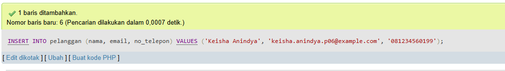

### UJ-02 — email duplikat (negatif)

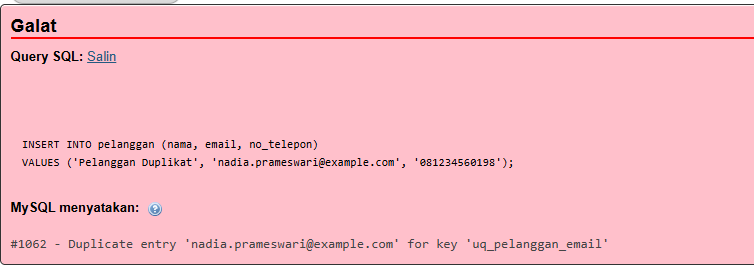

### UJ-03 — kategori tidak tersedia (negatif)

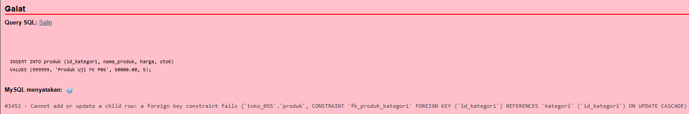

### UJ-04 — harga negatif (negatif)

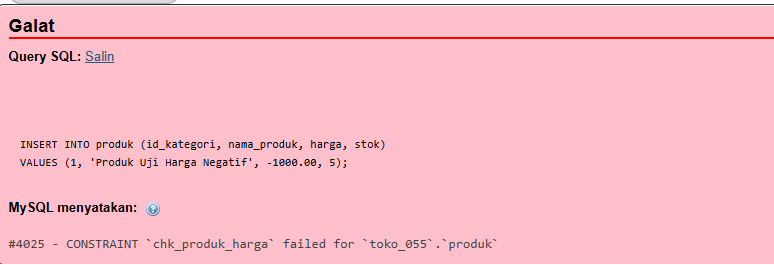

### UJ-05 — stok negatif (negatif)

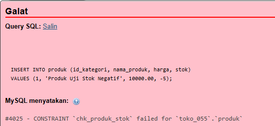

### UJ-06 — jumlah item keranjang nol (negatif)

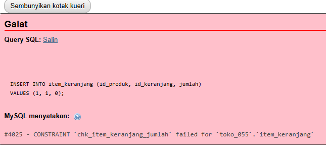

### UJ-07 — pelanggan pesanan tidak tersedia (negatif)

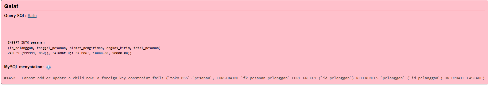

### UJ-08 — jumlah detail nol (negatif)

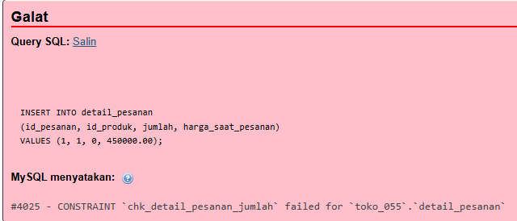

### UJ-09 — pembayaran kedua untuk pesanan yang sama (negatif)

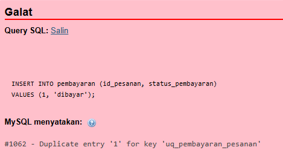

### UJ-10 — pengiriman kedua untuk pesanan yang sama (negatif)

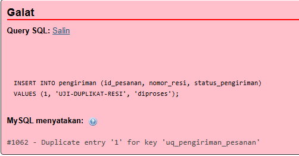

### UJ-11 — detail pesanan valid (positif)

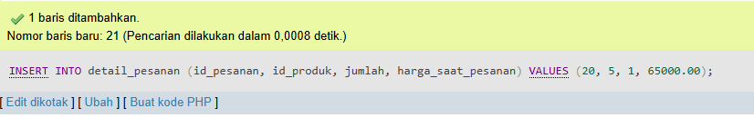

### UJ-12 — pesanan tanpa detail (uji celah AB-06)

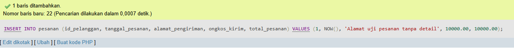

**Analisis:**

Pengujian positif menunjukkan bahwa database menerima data yang memenuhi ketentuan tabel. Pengujian negatif menunjukkan bahwa constraint seperti UNIQUE, FOREIGN KEY, dan CHECK menolak data yang tidak sesuai.

Pada UJ-12, pesanan tanpa detail dapat tersimpan. Hal ini menunjukkan bahwa aturan AB-06 belum ditegakkan secara langsung oleh constraint database.

### Hasil sebaran pesanan berdasarkan tanggal


**Hasil MariaDB:**

Perintah SQL berhasil dijalankan melalui phpMyAdmin dan menghasilkan perubahan data sesuai operasi yang dilakukan. Data yang ditambahkan masuk ke tabel tujuan, sedangkan data yang diubah atau dihapus mengikuti kondisi yang ditentukan pada perintah SQL. Hasil eksekusi dapat dilihat melalui pesan keberhasilan MariaDB dan pemeriksaan kembali menggunakan perintah SELECT.


## 6. Tugas Mandiri: Milestone Proyek 6

### 6.1 Identitas dan parameter proyek

Proyek yang dikerjakan adalah database Toko Daring dengan nama database `toko_055`. Struktur database mengikuti sembilan tabel pada rancangan P05.

Berdasarkan NIM 25430055, dua digit terakhir NIM adalah 55. Parameter P dihitung sebagai berikut:

\[
P = (55 \bmod 9) + 1 = 2
\]

Target transaksi utama dihitung menggunakan ketentuan 10 × P:

\[
10 \times P = 10 \times 2 = 20
\]

Dengan demikian, data sampel proyek disiapkan agar tabel `pesanan` memiliki 20 transaksi.

### 6.2 Struktur dan jumlah data sampel

Data sampel dimasukkan ke sembilan tabel yang telah dibuat pada P05. Rincian jumlah data berdasarkan hasil pemeriksaan MariaDB adalah:

| No. | Tabel | Jumlah data |
|---:|---|---:|
| 1 | `pelanggan` | 5 |
| 2 | `kategori` | 5 |
| 3 | `produk` | 10 |
| 4 | `keranjang` | 5 |
| 5 | `item_keranjang` | 10 |
| 6 | `pesanan` | 20 |
| 7 | `detail_pesanan` | 20 |
| 8 | `pembayaran` | 20 |
| 9 | `pengiriman` | 15 |

Jumlah tersebut menunjukkan bahwa data sampel telah berhasil dimasukkan ke seluruh tabel. Jumlah transaksi pada tabel `pesanan` mencapai 20 baris sesuai parameter proyek.

### 6.3 Sebaran transaksi

Data pesanan disiapkan pada empat tanggal berbeda, yaitu 4 sampai 7 Oktober 2026. Pemeriksaan dilakukan menggunakan `GROUP BY DATE(tanggal_pesanan)` untuk menghitung jumlah pesanan pada setiap tanggal.

**Gambar 6.1. Hasil pemeriksaan sebaran transaksi.**


### 6.4 Dokumentasi skenario pengujian

Sebanyak 12 skenario pengujian disiapkan pada dokumen `p06_uji_25430055.md`. Skenario tersebut mencakup:

- Penambahan data pelanggan valid.
- Pengujian email duplikat.
- Pengujian foreign key kategori dan pelanggan.
- Pengujian CHECK pada harga, stok, dan jumlah.
- Pengujian UNIQUE pada pembayaran dan pengiriman.
- Penambahan detail pesanan yang valid.
- Pengujian pesanan tanpa detail untuk memeriksa aturan AB-06.

Ringkasan hasil pengujian harus diisi setelah seluruh query dijalankan.

| Kelompok pengujian | Skenario | Hasil aktual |
|---|---|---|
| Positif | UJ-01 dan UJ-11 | 	Kedua query berhasil dijalankan. Masing-masing menambahkan satu baris data ke tabel pelanggan dan detail_pesanan. |
| Negatif | UJ-02 sampai UJ-10 | [Seluruh query ditolak oleh database sesuai constraint yang diuji, yaitu UNIQUE, FOREIGN KEY, dan CHECK.] |
| Pemeriksaan aturan bisnis | UJ-12 | Pesanan tanpa detail berhasil disimpan. Hasil pemeriksaan menunjukkan jumlah_detail = 0, sehingga aturan AB-06 belum ditegakkan secara langsung oleh database. |

### 6.5 Batasan dan utang desain

Berdasarkan struktur ERD fisik dan DDL P05, terdapat beberapa aturan bisnis yang belum sepenuhnya dapat dijamin oleh constraint sederhana.

1. **AB-04 — satu keranjang aktif per pelanggan.** Struktur tabel `keranjang` belum memiliki atribut penanda status aktif. Karena itu, struktur saat ini belum dapat membedakan keranjang aktif dan tidak aktif untuk membatasi satu keranjang aktif per pelanggan.
2. **AB-06 — setiap pesanan memiliki minimal satu detail.** Foreign key pada `detail_pesanan` memastikan detail merujuk ke pesanan yang tersedia. Namun, foreign key tersebut tidak mewajibkan setiap pesanan mempunyai setidaknya satu detail.
3. **AB-10 — pengiriman setelah pembayaran dikonfirmasi.** Relasi foreign key dan UNIQUE pada tabel pengiriman tidak dengan sendirinya memeriksa status pembayaran pada tabel pembayaran.

Batasan tersebut perlu dicatat sebagai utang desain dan ditangani menggunakan mekanisme tambahan pada tahap pengembangan berikutnya. Untuk AB-06, hasil UJ-12 harus dicatat berdasarkan hasil eksekusi yang sebenarnya.

## 7. Pembahasan dan Kendala

Pengisian data sampel pada database `toko_055` menghasilkan jumlah baris sesuai target yang telah ditentukan. Seluruh sembilan tabel memiliki data, dan tabel `pesanan` berisi 20 baris. Data pesanan juga dirancang tersebar pada empat tanggal berbeda.

Pemeriksaan jumlah baris merupakan langkah verifikasi awal untuk memastikan proses pengisian data telah berjalan. Namun, jumlah baris saja belum membuktikan seluruh aturan bisnis telah dipenuhi. Oleh karena itu, pengujian positif dan negatif tetap diperlukan untuk memeriksa constraint pada database.

**Kendala yang ditemukan:**

Selama proses pengujian database, ditemukan beberapa kendala berupa penolakan data oleh constraint yang telah diterapkan. Kendala tersebut meliputi:

1. **Error #1062 (Duplicate entry):** Terjadi ketika memasukkan email pelanggan yang sudah terdaftar serta mencoba menambahkan pembayaran atau pengiriman kedua untuk pesanan yang sama. Hal ini disebabkan oleh constraint `UNIQUE`. Pengujian dinyatakan sesuai harapan karena database berhasil mencegah data duplikat.
2. **Error #1452 (Foreign key constraint fails):** Terjadi ketika memasukkan produk dengan kategori yang tidak tersedia dan pesanan dengan pelanggan yang tidak terdaftar. Hal ini disebabkan oleh pelanggaran constraint `FOREIGN KEY`. Perbaikannya adalah menggunakan ID referensi yang tersedia pada tabel terkait.
3. **Error #4025 (CHECK constraint failed):** Terjadi ketika memasukkan harga negatif, stok negatif, serta jumlah item keranjang dan detail pesanan bernilai nol. Hal ini disebabkan oleh nilai yang tidak memenuhi ketentuan constraint `CHECK`. Perbaikannya adalah menggunakan nilai yang sesuai dengan aturan database.

Secara keseluruhan, kendala tersebut merupakan hasil pengujian terhadap constraint database, bukan kerusakan sistem. Namun, pengujian UJ-12 juga menunjukkan bahwa aturan AB-06 (setiap pesanan harus memiliki minimal satu detail) belum ditegakkan secara langsung oleh database. Hal ini menjadi catatan untuk pengembangan selanjutnya.

## 8. Kesimpulan

Praktikum P06 menerapkan pengisian data sampel dan pemeriksaan data pada database Toko Daring. Berdasarkan hasil pemeriksaan MariaDB, sembilan tabel telah terisi dengan jumlah 5 pelanggan, 5 kategori, 10 produk, 5 keranjang, 10 item keranjang, 20 pesanan, 20 detail pesanan, 20 pembayaran, dan 15 pengiriman.

Jumlah 20 pesanan telah memenuhi target transaksi proyek berdasarkan parameter P = 2. Tahap pengujian constraint dilakukan melalui 12 skenario yang mencakup uji positif, uji negatif, dan pemeriksaan batasan aturan bisnis. Kesimpulan akhir mengenai keberhasilan setiap constraint harus ditetapkan setelah seluruh skenario dijalankan dan hasil aktual dicatat.

## 9. Pernyataan Penggunaan AI

AI digunakan sebagai alat bantu dalam penyusunan contoh data SQL, perancangan awal skenario pengujian, dan penyusunan dokumentasi laporan. Perintah SQL dijalankan dan hasilnya diverifikasi oleh praktikan melalui MariaDB/phpMyAdmin. Hasil aktual, pesan error, dan screenshot yang dilampirkan harus berasal dari pelaksanaan praktikum.

## 10. Bukti Git

**Repository:** https://github.com/raihanar575-cmd/basisdata-25430055

Berkas P06 yang disimpan dalam repository:

- `p06_data_25430055.sql`
- `p06_uji_25430055.md`
- `laporan/p06_laporan_25430055.md`
- Screenshot bukti pada folder `laporan/img/`


## Checklist Pengumpulan

- [x] Skrip `p06_data_25430055.sql` dibuat.
- [x] Dokumen `p06_uji_25430055.md` dibuat dengan 12 skenario.
- [x] Data sampel berhasil dimasukkan ke sembilan tabel.
- [x] Tabel `pesanan` berisi 20 baris.
- [x] Sebaran tanggal transaksi dibuktikan dengan screenshot.
- [x] Seluruh 12 skenario dijalankan dan hasil aktual dicatat.
- [x] Minimal lima skenario negatif dibuktikan dengan hasil MariaDB.
- [x] Pengujian aturan AB-06 dicatat sebagai temuan jika terbukti.
- [x] Screenshot hasil praktik dimasukkan ke `laporan/img/`.
- [x] Laporan dan berkas P06 di-commit dan di-push ke GitHub.
