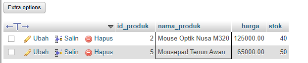
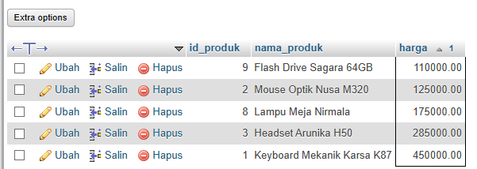
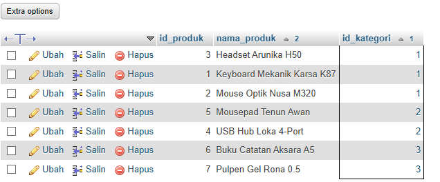
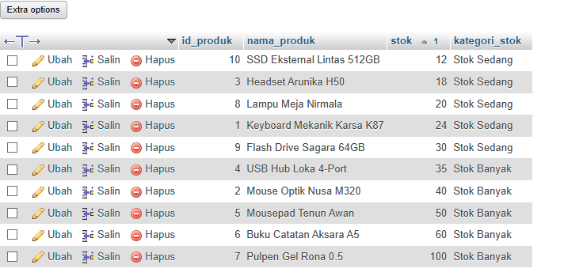
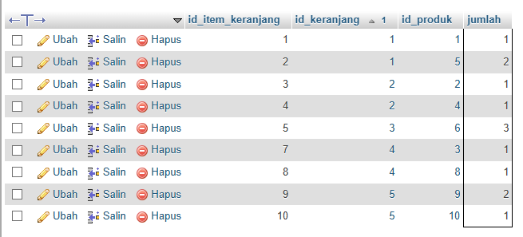
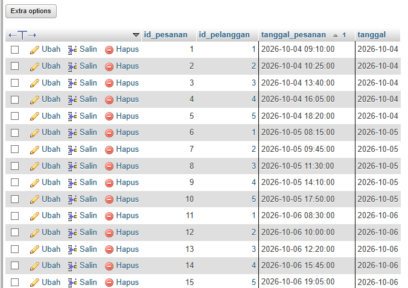
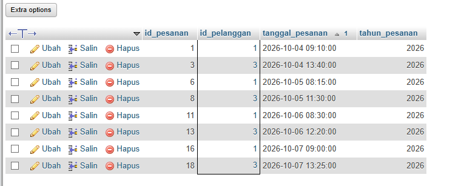
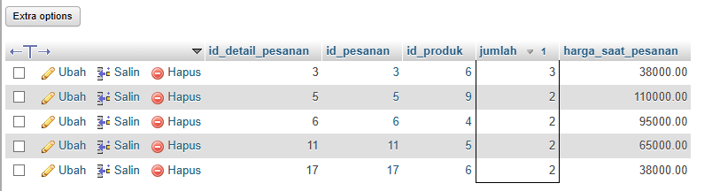
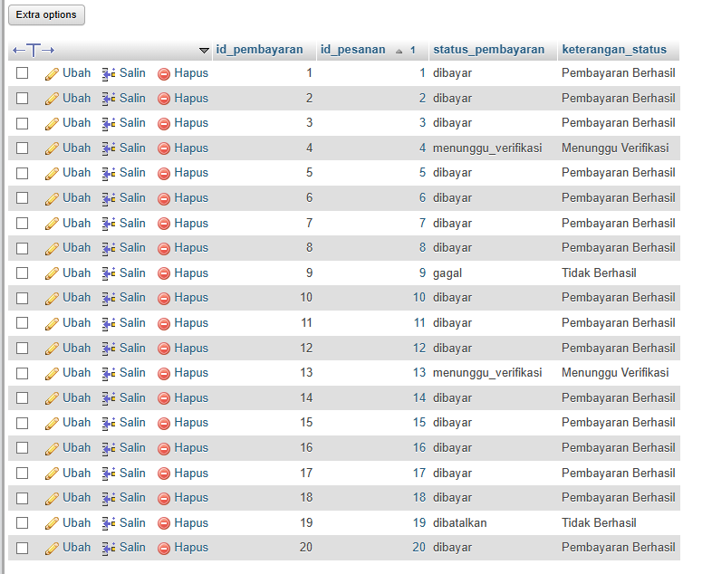
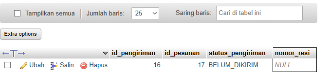

# Laporan Praktikum Basis Data - Pertemuan 7

- Nama: Raihan Ardani
- NIM: 25430055
- Kelas: C
- Mata Kuliah: Praktikum Basis Data
- Pertemuan: 7
- Dosen Pengampu: Dedi Irawan, S.Kom., M.T.I
- Tanggal: 11/11/2026

## 1. Tujuan Praktikum
1. Memahami kueri SQL satu tabel (*single-table query*).
2. Menggunakan `LIKE`, `BETWEEN`, `IN`, `IS NULL`, dan `CASE`.
3. Menggunakan fungsi tanggal dan fungsi string.
4. Membuat minimal 10 kueri satu tabel yang mendukung Kebutuhan Informasi (KI) proyek Toko Daring.
5. Memetakan kueri terhadap KI dan menandai KI yang memerlukan lebih dari satu tabel.

## 2. Ringkasan Dasar Teori
Kueri satu tabel mengambil atau mengolah data dari satu tabel tanpa menggabungkannya dengan tabel lain. `SELECT` menentukan kolom yang ditampilkan, sedangkan `WHERE` menyaring baris.

- `LIKE`: mencari teks berdasarkan pola.
- `BETWEEN`: menyaring nilai dalam rentang.
- `IN`: mencocokkan nilai dengan daftar pilihan.
- `IS NULL`: memeriksa nilai yang belum terisi.
- `CASE`: menghasilkan nilai berdasarkan kondisi.
- Fungsi tanggal: mengolah atau mengambil bagian dari tanggal/waktu.
- Fungsi string: mengolah teks, misalnya mengubah huruf menjadi kapital.

Setiap kueri proyek diberi komentar berisi kode KI, pertanyaan sehari-hari, dan hasil yang diharapkan sebelum dijalankan.

## 3. Hasil Langkah Percobaan

### 3.1 Praktik kueri
Pada tahap ini dilakukan praktik pembuatan dan eksekusi kueri SQL menggunakan MariaDB melalui phpMyAdmin. Kueri yang diuji mencakup penggunaan operator pencarian, penyaringan, pengelompokan, fungsi tanggal, dan fungsi string. Hasil eksekusi masing-masing kueri ditampilkan pada subbab berikutnya.

## 4. Jawaban Titik Analisis

### 4.1 Urutan evaluasi SQL
Secara konseptual, urutan pemrosesan kueri yang umum adalah `FROM`, `WHERE`, `GROUP BY`, `HAVING`, `SELECT`, lalu `ORDER BY`. Karena itu, alias yang dibuat pada `SELECT` umumnya tidak dapat langsung digunakan di `WHERE` pada tingkat kueri yang sama.

### 4.2 Nilai NULL
`NULL` berarti nilai tidak diketahui atau belum tersedia, bukan angka nol atau teks kosong. Gunakan `IS NULL` atau `IS NOT NULL`, bukan `= NULL`.

### 4.3 Subtotal dan total nota
Subtotal satu baris detail dapat dihitung dari jumlah dikalikan harga satuan. Total nota yang menjumlahkan banyak baris membutuhkan fungsi agregat seperti `SUM()`, yang dipelajari pada pertemuan berikutnya.

## 5. Hasil Latihan dan Modifikasi

### 5.1 Menampilkan nama produk dalam huruf kapital dan harga dalam format rupiah
```sql
SELECT
    UPPER(nama_produk) AS nama_produk,
    CONCAT('Rp', FORMAT(harga, 0, 'id_ID')) AS harga_format
FROM produk;
```
**Hasil aktual:** Kueri menampilkan seluruh data produk dengan nama produk yang diubah menjadi huruf kapital menggunakan fungsi UPPER(). Harga ditampilkan dalam format rupiah menggunakan fungsi CONCAT() dan FORMAT(). Setiap baris menampilkan dua kolom, yaitu nama_produk dan harga_format. Data produk tetap sama, hanya format tampilannya yang berubah.

### 5.2 Kueri yang salah secara semantik dan perbaikannya
Contoh kondisi yang keliru karena prioritas `AND` dan `OR`:

```sql
-- Contoh keliru: rentang harga tidak diterapkan pada seluruh kondisi.
SELECT id_produk, nama_produk, harga, stok
FROM produk
WHERE harga >= 100000 OR harga <= 500000
  AND stok > 0;
```

Perbaikan jika maksudnya harga Rp100.000–Rp500.000 dan stok tersedia:

```sql
SELECT id_produk, nama_produk, harga, stok
FROM produk
WHERE harga BETWEEN 100000 AND 500000
  AND stok > 0;
```

**Hasil aktual dan perbedaan:** Pada kueri pertama, operator AND memiliki prioritas lebih tinggi daripada OR. Kondisi tersebut dibaca sebagai harga >= 100000 OR (harga <= 500000 AND stok > 0). Akibatnya, produk dengan harga minimal Rp100.000 tetap dapat ditampilkan meskipun stoknya kosong, sedangkan produk dengan harga maksimal Rp500.000 hanya ditampilkan jika stoknya tersedia.

Pada kueri kedua, penggunaan BETWEEN memastikan harga berada dalam rentang Rp100.000 sampai Rp500.000, kemudian kondisi AND stok > 0 memastikan hanya produk yang masih memiliki stok yang ditampilkan. Dengan demikian, kueri kedua lebih sesuai dengan tujuan pencarian dan menghasilkan penyaringan data yang lebih tepat.

## 6. Tugas Mandiri: Milestone Proyek 7

### 6.1 Deskripsi
Milestone P07 adalah membuat minimal 10 kueri satu tabel yang mendukung KI proyek Toko Daring. Berkas wajib: `p07_kueri_25430055.sql`.

Setiap kueri harus diberi komentar yang memuat kode KI, pertanyaan dalam bahasa sehari-hari, dan hasil yang diharapkan. Kueri harus menggunakan `LIKE`, `BETWEEN`, `IN`, `IS NULL`, `CASE`, minimal satu fungsi tanggal, dan minimal satu fungsi string.

### 6.2 Pemetaan kueri terhadap KI
Tabel berikut merupakan rancangan pemetaan. Sesuaikan dengan isi final file SQL yang benar-benar dibuat dan dijalankan.

| No. | KI | Pertanyaan informasi | Tabel | Fitur SQL |
|---:|---|---|---|---|
| 1 | KI-01 | Produk apa yang namanya mengandung kata tertentu? | `produk` | `LIKE` |
| 2 | KI-01 | Produk apa yang harganya berada dalam rentang tertentu? | `produk` | `BETWEEN` |
| 3 | KI-01 | Produk apa yang stoknya termasuk nilai pilihan? | `produk` | `IN` |
| 4 | KI-01 | Bagaimana kategori stok produk berdasarkan jumlah stok? | `produk` | `CASE` |
| 5 | KI-02 | Item keranjang mana yang memiliki jumlah tertentu? | `item_keranjang` | `IN` |
| 6 | KI-03 | Pesanan apa yang dibuat dalam rentang tanggal tertentu? | `pesanan` | `BETWEEN`, fungsi tanggal |
| 7 | KI-03 | Pesanan apa yang dimiliki pelanggan tertentu? | `pesanan` | `IN` |
| 8 | KI-04 | Detail pesanan mana yang memiliki jumlah dalam rentang tertentu? | `detail_pesanan` | `BETWEEN` |
| 9 | KI-05 | Pembayaran mana yang memiliki status tertentu? | `pembayaran` | `IN`, `CASE` |
| 10 | KI-05 | Pengiriman mana yang belum memiliki nomor resi? | `pengiriman` | `IS NULL` |

### 6.3 Bukti Hasil Kueri

#### 6.3.1 Kueri 01 – Pencarian Produk Menggunakan LIKE


#### 6.3.2 Kueri 02 – Penyaringan Harga Menggunakan BETWEEN


#### 6.3.3 Kueri 03 – Penyaringan Kategori Menggunakan IN


#### 6.3.4 Kueri 04 – Pengelompokan Stok Menggunakan CASE


#### 6.3.5 Kueri 05 – Penyaringan Jumlah Item Menggunakan IN


#### 6.3.6 Kueri 06 – Penyaringan Tanggal Pesanan Menggunakan BETWEEN


#### 6.3.7 Kueri 07 – Pencarian Pesanan Berdasarkan Pelanggan dan Tahun


#### 6.3.8 Kueri 08 – Penyaringan Detail Pesanan Berdasarkan Jumlah


#### 6.3.9 Kueri 09 – Pengelompokan Status Pembayaran Menggunakan CASE


#### 6.3.10 Kueri 10 – Pemeriksaan Nomor Resi Kosong Menggunakan IS NULL



### 6.4 KI yang belum dapat dijawab dengan satu tabel
KI yang memerlukan informasi gabungan dari beberapa tabel belum dapat dijawab secara lengkap pada P07. Contohnya, menampilkan riwayat pesanan beserta nama produk dan rincian pembayaran membutuhkan penggabungan beberapa tabel. Tandai kebutuhan tersebut untuk dilanjutkan pada Pertemuan 9–12.

### 6.5 Alasan pemilihan fitur
- `LIKE` untuk pencarian nama produk berdasarkan pola.
- `BETWEEN` untuk rentang harga atau tanggal.
- `IN` untuk beberapa nilai pilihan.
- `IS NULL` untuk menemukan data tanpa nomor resi.
- `CASE` untuk mengelompokkan nilai atau status.
- Fungsi tanggal untuk mengambil atau mengolah tanggal pesanan.
- Fungsi string untuk mengubah atau memformat nama produk.

## 7. Pembahasan dan Kendala
Berdasarkan rancangan 10 kueri yang dibuat, setiap kueri memiliki tujuan untuk mengambil dan menyaring informasi dari satu tabel sesuai kebutuhan informasi yang telah ditentukan. Fitur wajib telah diterapkan, yaitu LIKE untuk pencarian teks, BETWEEN untuk menyaring rentang nilai atau tanggal, IN untuk memilih beberapa nilai, IS NULL untuk memeriksa nilai kosong, CASE untuk mengelompokkan data, serta fungsi tanggal dan fungsi string untuk mengolah nilai dalam kolom.

Seluruh kueri dirancang hanya mengakses satu tabel dan tidak menggunakan JOIN. Hasil kosong tetap dianggap sebagai hasil yang valid apabila tidak terdapat baris yang memenuhi kondisi pencarian. Nilai NULL diperiksa menggunakan IS NULL, bukan operator perbandingan biasa. Sementara itu, pengurutan hasil menggunakan ORDER BY agar data lebih mudah dibaca dan dianalisis.

Kendala yang ditemukan:

Pada kueri yang menggunakan IS NULL, hasil dapat kosong karena seluruh data pada kolom nomor_resi telah memiliki nilai. Hal ini bukan merupakan kesalahan sintaks, melainkan menunjukkan bahwa tidak ada data yang memenuhi kondisi tersebut. Untuk menguji hasil yang tidak kosong, dapat ditambahkan data pengiriman dengan nomor_resi bernilai NULL. Kendala lain dan pesan galat belum dapat dipastikan karena perlu disesuaikan dengan hasil eksekusi langsung di MariaDB.

## 8. Kesimpulan
Praktikum P07 membahas kueri satu tabel untuk mengambil dan menyaring informasi dari database. Operator LIKE, BETWEEN, IN, IS NULL, ekspresi CASE, fungsi tanggal, dan fungsi string diterapkan dalam kueri proyek Toko Daring.

Melalui milestone ini disusun 10 kueri satu tabel yang dipetakan terhadap kebutuhan informasi (KI). Setiap kueri menggunakan kondisi dan fungsi yang berbeda untuk menghasilkan informasi sesuai kebutuhan. Kebutuhan informasi yang memerlukan data dari beberapa tabel ditandai untuk dilanjutkan pada pertemuan berikutnya.

Kesimpulan berdasarkan hasil praktik:

Melalui penyusunan dan pengujian kueri, dapat dipahami bahwa SQL menyediakan berbagai operator dan fungsi untuk melakukan pencarian, penyaringan, pengelompokan, serta pengurutan data. Hasil kueri juga menunjukkan bahwa hasil kosong tidak selalu menandakan kesalahan, tetapi dapat terjadi karena tidak ada data yang sesuai dengan kondisi yang diberikan. Dengan demikian, praktikum ini menjadi dasar untuk memahami pengambilan data sebelum mempelajari kueri yang melibatkan beberapa tabel.

## 9. Pernyataan Penggunaan AI
AI digunakan sebagai alat bantu untuk memahami konsep SQL, menyusun kerangka kueri, dan merapikan dokumentasi. Kueri dan hasilnya harus diperiksa serta diuji kembali oleh praktikan. Hasil aktual, screenshot, dan analisis akhir disesuaikan dengan pelaksanaan praktikum.

## 10. Bukti Git
**Repositori:** https://github.com/raihanar575-cmd/basisdata-25430055

**Berkas:** `p07_kueri_25430055.sql`, `laporan/p07_laporan_25430055.md`, dan screenshot di `laporan/img/`.


## Checklist
- [x] File `p07_kueri_25430055.sql` tersedia.
- [x] Minimal 10 kueri satu tabel telah dibuat.
- [x] Setiap kueri memiliki komentar KI, pertanyaan, dan hasil yang diharapkan.
- [x] `LIKE`, `BETWEEN`, `IN`, `IS NULL`, dan `CASE` telah digunakan.
- [x] Minimal satu fungsi tanggal dan satu fungsi string telah digunakan.
- [x] Screenshot hasil setiap kueri telah dilampirkan.
- [x] Pemetaan kueri terhadap KI telah dijelaskan.
- [x] KI yang memerlukan lebih dari satu tabel telah ditandai.
- [x] Laporan disimpan di `laporan/p07_laporan_25430055.md`.
- [x] Perubahan telah di-commit dan di-push.
