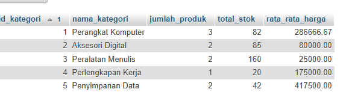
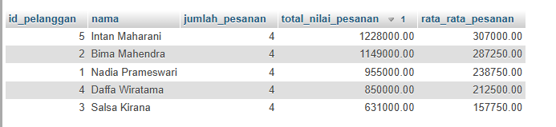
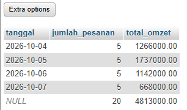
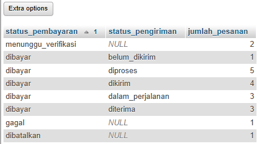
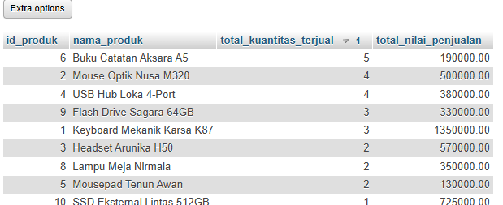

# Laporan Praktikum Basis Data - Pertemuan 9

- Nama: Raihan Ardani
- NIM: 25430055
- Kelas: C
- Mata Kuliah: Praktikum Basis Data
- Pertemuan: 9
- Dosen Pengampu: Dedi Irawan, S.Kom., M.T.I
- Tanggal: 17/11/2026

## 1. Tujuan Praktikum

1. Memahami penggunaan fungsi agregat dalam SQL.
2. Mengelompokkan data menggunakan `GROUP BY`.
3. Menyaring hasil pengelompokan menggunakan `HAVING`.
4. Menggunakan `WITH ROLLUP` untuk menampilkan subtotal atau total keseluruhan.
5. Membuat minimal lima laporan ringkasan berdasarkan kebutuhan informasi proyek Toko Daring.
6. Menjalankan seluruh kueri dengan mode `ONLY_FULL_GROUP_BY` aktif.

## 2. Ringkasan Dasar Teori

Agregasi merupakan proses mengolah sejumlah baris data menjadi nilai ringkasan. MariaDB menyediakan beberapa fungsi agregat, antara lain:

- `COUNT()` untuk menghitung jumlah baris atau nilai.
- `SUM()` untuk menjumlahkan nilai.
- `AVG()` untuk menghitung nilai rata-rata.
- `MIN()` untuk mencari nilai terkecil.
- `MAX()` untuk mencari nilai terbesar.

`GROUP BY` digunakan untuk mengelompokkan baris berdasarkan satu atau beberapa kolom. Fungsi agregat kemudian dihitung untuk setiap kelompok.

`HAVING` digunakan untuk menyaring kelompok berdasarkan hasil agregasi. Berbeda dengan `WHERE` yang menyaring baris sebelum proses pengelompokan, `HAVING` menyaring hasil setelah `GROUP BY`.

`WITH ROLLUP` menambahkan baris ringkasan pada hasil pengelompokan, termasuk total keseluruhan. Nilai `NULL` yang muncul pada kolom pengelompokan di baris tambahan tersebut menandakan tingkat subtotal atau total, bukan selalu data yang benar-benar kosong.

Mode `ONLY_FULL_GROUP_BY` memastikan kolom yang ditampilkan bersama fungsi agregat harus tercantum dalam `GROUP BY` atau digunakan di dalam fungsi agregat, sehingga hasil pengelompokan tidak ambigu.

## 3. Hasil Langkah Percobaan

### 3.1 Menyiapkan database dan mode pengelompokan

Database yang digunakan adalah `toko_055`, yaitu database proyek Toko Daring. Struktur tabel mengikuti DDL P05 dan data sampel mengikuti skrip P06.

Mode `ONLY_FULL_GROUP_BY` diaktifkan untuk sesi MariaDB menggunakan perintah berikut:

```sql
SET SESSION sql_mode =
    CONCAT(@@sql_mode, ',ONLY_FULL_GROUP_BY');

SELECT @@sql_mode AS mode_sql_aktif;
```

### 3.2 Menjalankan kueri laporan ringkasan

Seluruh kueri laporan disimpan dalam berkas `p09_agregasi_25430055.sql`. Setiap laporan memiliki komentar yang menjelaskan kode KI, pertanyaan yang ingin dijawab, dan hasil yang diharapkan.

#### 3.2.1 Laporan 1 – Ringkasan Produk Berdasarkan Kategori

**Pemetaan KI:** KI-01 – Informasi produk berdasarkan kategori.

Laporan ini menampilkan jumlah produk, total stok, dan rata-rata harga untuk setiap kategori. Kueri menggunakan `COUNT()`, `SUM()`, dan `AVG()` serta mengelompokkan hasil berdasarkan kategori.

**Bukti screenshot:** `img/p09_kueri_01.png`



#### 3.2.2 Laporan 2 – Ringkasan Pesanan Berdasarkan Pelanggan

**Pemetaan KI:** KI-03 – Riwayat pesanan pelanggan.

Laporan ini menampilkan jumlah pesanan, total nilai pesanan, dan rata-rata nilai pesanan setiap pelanggan. Kueri menggunakan `COUNT()`, `SUM()`, dan `AVG()`. Klausa `HAVING COUNT(...) >= 3` digunakan untuk menampilkan pelanggan yang memiliki minimal tiga pesanan.

**Bukti screenshot:** `img/p09_kueri_02.png`



#### 3.2.3 Laporan 3 – Ringkasan Pesanan dan Omzet Berdasarkan Tanggal

**Pemetaan KI:** KI-04 – Informasi detail pesanan, produk, jumlah, dan harga saat pembelian.

Laporan ini menampilkan jumlah pesanan dan total omzet berdasarkan tanggal pesanan. Kueri menggunakan `COUNT()` dan `SUM()` serta `WITH ROLLUP` untuk menambahkan total keseluruhan.

Baris yang memiliki nilai `NULL` pada kolom tanggal merupakan baris total keseluruhan yang dihasilkan oleh `WITH ROLLUP`, bukan tanggal pesanan yang kosong.

**Bukti screenshot:** `img/p09_kueri_03.png`



#### 3.2.4 Laporan 4 – Ringkasan Status Pembayaran dan Pengiriman

**Pemetaan KI:** KI-05 – Informasi status pembayaran dan pengiriman.

Laporan ini menghitung jumlah pesanan berdasarkan kombinasi status pembayaran dan status pengiriman. Kueri menggunakan `COUNT()` dan pengelompokan berdasarkan kedua kolom status. `LEFT JOIN` digunakan agar pesanan yang belum memiliki data pengiriman tetap dapat ditampilkan.

Apabila status pengiriman bernilai `NULL`, hal tersebut menunjukkan bahwa pesanan tersebut belum memiliki pasangan data pada tabel pengiriman.

**Bukti screenshot:** `img/p09_kueri_04.png`



#### 3.2.5 Laporan 5 – Ringkasan Kuantitas dan Nilai Penjualan Produk

**Pemetaan KI:** KI-04 – Informasi detail pesanan, produk, jumlah, dan harga saat pembelian.

Laporan ini menampilkan total kuantitas produk yang terjual serta total nilai penjualannya. Nilai penjualan dihitung dari jumlah produk dikalikan harga saat pesanan, kemudian dijumlahkan menggunakan `SUM()` untuk setiap produk.

**Bukti screenshot:** `img/p09_kueri_05.png`



## 4. Jawaban Titik Analisis

### 4.1 Perbedaan WHERE dan HAVING

`WHERE` digunakan untuk menyaring baris sebelum data dikelompokkan oleh `GROUP BY`. Sementara itu, `HAVING` digunakan untuk menyaring kelompok setelah fungsi agregat dihitung. Oleh karena itu, kondisi yang bergantung pada hasil `COUNT()`, `SUM()`, atau `AVG()` umumnya ditempatkan pada `HAVING`.

### 4.2 Penggunaan ONLY_FULL_GROUP_BY

Mode `ONLY_FULL_GROUP_BY` mencegah kueri agregasi menampilkan kolom yang tidak memiliki hubungan pengelompokan yang jelas. Kolom biasa yang ditampilkan bersama fungsi agregat harus dicantumkan pada `GROUP BY`, kecuali jika kolom tersebut juga dihitung menggunakan fungsi agregat.

### 4.3 Arti NULL pada WITH ROLLUP

Nilai `NULL` yang muncul pada baris tambahan `WITH ROLLUP` menandakan ringkasan untuk kelompok yang lebih tinggi. Pada laporan omzet per tanggal, baris dengan tanggal `NULL` menunjukkan total seluruh tanggal. Baris tersebut harus dibedakan dari nilai `NULL` yang benar-benar tersimpan pada data.

### 4.4 Perilaku fungsi agregat terhadap NULL

`COUNT(*)` menghitung seluruh baris, sedangkan `COUNT(kolom)` hanya menghitung nilai yang bukan `NULL`. Fungsi `SUM()`, `AVG()`, `MIN()`, dan `MAX()` mengabaikan nilai `NULL` dalam kolom yang dihitung.

## 5. Hasil Latihan dan Modifikasi

Pada tahap ini dilakukan pengembangan kueri laporan ringkasan untuk database Toko Daring. Lima laporan dibuat dengan fungsi agregat dan pengelompokan sesuai kebutuhan informasi proyek. Salah satu laporan menggunakan `HAVING` untuk menyaring pelanggan berdasarkan jumlah pesanan, sedangkan laporan lainnya menggunakan `WITH ROLLUP` untuk menampilkan total omzet keseluruhan.

**Hasil aktual:**

Berdasarkan hasil eksekusi, kelima kueri berhasil menghasilkan laporan ringkasan dari database Toko Daring. Fungsi agregat `COUNT()`, `SUM()`, dan `AVG()` digunakan untuk menghitung jumlah data, total nilai, serta rata-rata. Penggunaan `GROUP BY` berhasil mengelompokkan data berdasarkan kategori produk, pelanggan, tanggal pesanan, status pembayaran dan pengiriman, serta produk yang terjual.

Klausa `HAVING` berhasil menyaring pelanggan yang memiliki minimal tiga pesanan. Sementara itu, `WITH ROLLUP` berhasil menampilkan total omzet keseluruhan selain ringkasan omzet berdasarkan tanggal. Hasil tersebut menunjukkan bahwa fungsi agregasi dapat membantu menyajikan data transaksi menjadi informasi yang lebih ringkas dan mudah dianalisis.

## 6. Hasil Milestone Proyek 9

Berkas proyek yang dihasilkan adalah:

- `p09_agregasi_25430055.sql`

Berkas tersebut berisi lima kueri laporan ringkasan yang dipetakan ke kebutuhan informasi proyek Toko Daring. Laporan mencakup ringkasan produk per kategori, pesanan per pelanggan, omzet per tanggal, status pembayaran dan pengiriman, serta kuantitas dan nilai penjualan produk.

**Pemeriksaan milestone:**

- [x] Terdapat minimal lima laporan ringkasan.
- [x] Setiap laporan memiliki pemetaan KI.
- [x] Minimal satu laporan menggunakan `HAVING`.
- [x] Minimal satu laporan menggunakan `WITH ROLLUP`.
- [x] `ONLY_FULL_GROUP_BY` aktif saat kueri dijalankan.
- [x] Setiap laporan memiliki minimal tiga kelompok.
- [x] Screenshot hasil eksekusi setiap laporan telah disimpan.

## 7. Pembahasan dan Kendala

Lima kueri disusun untuk menghasilkan informasi ringkasan dari database Toko Daring. Fungsi agregat digunakan untuk menghitung jumlah, total, dan rata-rata data. `GROUP BY` digunakan untuk membentuk kelompok berdasarkan kategori, pelanggan, tanggal, status, atau produk.

Penggunaan `HAVING` memungkinkan penyaringan berdasarkan hasil agregasi, sedangkan `WITH ROLLUP` memberikan total keseluruhan selain ringkasan per kelompok. Mode `ONLY_FULL_GROUP_BY` digunakan untuk memastikan kolom yang ditampilkan sesuai dengan aturan pengelompokan.

**Kendala yang ditemukan:**

Dalam proses pembuatan kueri agregasi, perlu diperhatikan penggunaan `GROUP BY` agar setiap kolom yang ditampilkan sesuai dengan aturan `ONLY_FULL_GROUP_BY`. Selain itu, penggunaan `HAVING` harus disesuaikan dengan fungsi agregat yang digunakan agar penyaringan kelompok berjalan dengan benar. Pada penggunaan `WITH ROLLUP`, baris dengan nilai `NULL` perlu dibedakan dari data kosong karena baris tersebut menunjukkan total keseluruhan. Kendala tersebut dapat diatasi dengan memeriksa kembali struktur kueri, kolom pengelompokan, dan hasil eksekusi di MariaDB.

**Catatan pemeriksaan:** Pastikan seluruh kueri benar-benar menghasilkan minimal tiga kelompok pada data yang digunakan. Jika jumlah kelompok belum mencukupi, periksa data sampel dan tambahkan data yang diperlukan tanpa mengubah struktur atau aturan bisnis secara sembarangan.

## 8. Kesimpulan

Praktikum P09 membahas penggunaan fungsi agregat dan pengelompokan data menggunakan SQL. Fungsi `COUNT()`, `SUM()`, dan `AVG()` digunakan untuk menghasilkan ringkasan, sedangkan `GROUP BY` digunakan untuk mengelompokkan data berdasarkan kategori tertentu.

Klausa `HAVING` digunakan untuk menyaring hasil pengelompokan dan `WITH ROLLUP` digunakan untuk menampilkan total keseluruhan. Mode `ONLY_FULL_GROUP_BY` membantu memastikan kueri agregasi menghasilkan data yang konsisten dan tidak ambigu.

Melalui milestone ini disusun lima laporan ringkasan untuk proyek Toko Daring yang dipetakan ke kebutuhan informasi. **Kesimpulan berdasarkan hasil praktik:** [tambahkan kesimpulan sesuai hasil eksekusi sebenarnya].

## 9. Pernyataan Penggunaan AI

AI digunakan sebagai alat bantu untuk memahami materi agregasi SQL, menyusun rancangan kueri, dan membantu penyusunan dokumentasi praktikum. Kueri tetap perlu diperiksa dan dijalankan secara mandiri pada MariaDB. Hasil aktual yang dicantumkan dalam laporan disesuaikan dengan keluaran eksekusi.

## 10. Bukti Git dan Checklist Pengumpulan

Berkas proyek P09 disimpan pada repositori GitHub dalam direktori proyek.

**Perintah Git yang digunakan:**

```bash
git commit -m "P09-Menambahkan laporan agregasi dan kueri ringkasan"
git push origin main
```

**Checklist akhir:**

- [x] `p09_agregasi_25430055.sql` tersedia.
- [x] `laporan/p09_laporan_25430055.md` tersedia.
- [x] Screenshot lima laporan tersedia di `laporan/img/`.
- [x] Semua kueri telah diuji dengan `ONLY_FULL_GROUP_BY` aktif.
- [x] Hasil aktual dan kendala telah dicatat.
- [x] Perubahan telah di-commit dan di-push ke GitHub.
