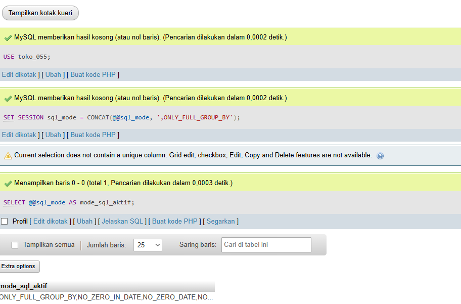
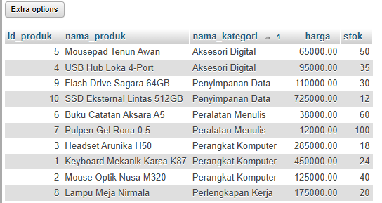
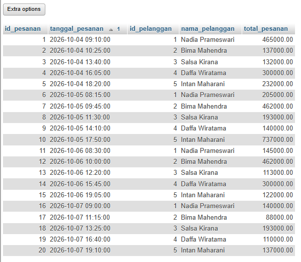
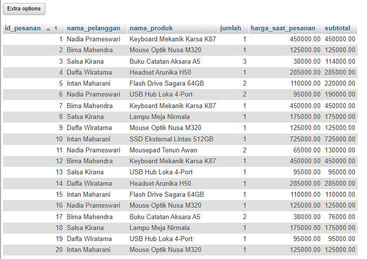
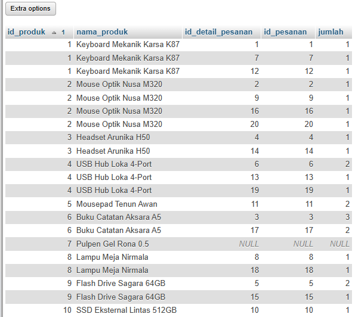
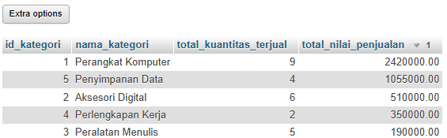

# Laporan Praktikum Basis Data - Pertemuan 10

- Nama: Raihan Ardani
- NIM: 25430055
- Kelas: C
- Mata Kuliah: Praktikum Basis Data
- Pertemuan: 10
- Dosen Pengampu: Dedi Irawan, S.Kom., M.T.I
- Tanggal: 24/11/2026

## 1. Tujuan Praktikum

1. Memahami penggunaan `JOIN` untuk menggabungkan data dari beberapa tabel.
2. Menggunakan `INNER JOIN` untuk menampilkan baris yang memiliki pasangan pada tabel terkait.
3. Menggunakan `LEFT JOIN` untuk menampilkan seluruh baris dari tabel kiri, termasuk yang tidak memiliki pasangan.
4. Memahami penggunaan jalur relasi berdasarkan ERD.
5. Membuat minimal lima kueri lintas tabel yang menjawab kebutuhan informasi proyek Toko Daring.

## 2. Ringkasan Dasar Teori

`JOIN` digunakan untuk menggabungkan baris dari dua tabel atau lebih berdasarkan hubungan antarkolom, umumnya melalui pasangan primary key dan foreign key.

- `INNER JOIN` menampilkan baris yang memiliki pasangan pada kedua tabel.
- `LEFT JOIN` menampilkan seluruh baris dari tabel kiri. Jika tidak ada pasangan pada tabel kanan, kolom tabel kanan bernilai `NULL`.
- `RIGHT JOIN` menampilkan seluruh baris dari tabel kanan dan pasangan yang sesuai dari tabel kiri.
- `SELF JOIN` adalah penggabungan sebuah tabel dengan dirinya sendiri menggunakan alias.
- `JOIN` dengan agregasi menggabungkan tabel kemudian menghitung ringkasan menggunakan fungsi seperti `COUNT()` atau `SUM()`.

Setiap JOIN harus mengikuti jalur relasi pada ERD dan memiliki kondisi `ON` yang sesuai. JOIN tanpa kondisi penghubung dapat menimbulkan perkalian Kartesius, yaitu setiap baris dari satu tabel dipasangkan dengan setiap baris tabel lainnya. Hal tersebut dapat menyebabkan jumlah baris dan hasil agregasi menjadi keliru.

## 3. Hasil Langkah Percobaan

### 3.1 Persiapan database dan mode SQL

Database yang digunakan adalah `toko_055`, dengan struktur tabel dari P05 dan data sampel dari P06. Mode `ONLY_FULL_GROUP_BY` diaktifkan untuk sesi MariaDB.

```sql
USE toko_055;

SET SESSION sql_mode =
    CONCAT(@@sql_mode, ',ONLY_FULL_GROUP_BY');

SELECT @@sql_mode AS mode_sql_aktif;
```

**Bukti screenshot:** `img/p10_mode_sql.png`



### 3.2 Praktik kueri JOIN

#### 3.2.1 Kueri 1 – Produk Beserta Kategori

Kueri ini menggabungkan tabel `produk` dan `kategori` untuk menampilkan nama produk beserta kategori, harga, dan stoknya.

**Jalur ERD:** `kategori` → `produk`  
**Jenis JOIN:** `INNER JOIN`  
**Pemetaan KI:** KI-01 – Informasi produk berdasarkan kategori.

**Bukti screenshot:** `img/p10_kueri_01.png`



#### 3.2.2 Kueri 2 – Pesanan Beserta Pelanggan

Kueri ini menggabungkan tabel `pesanan` dan `pelanggan` untuk menampilkan tanggal pesanan, nama pelanggan, dan total pesanan.

**Jalur ERD:** `pelanggan` → `pesanan`  
**Jenis JOIN:** `INNER JOIN`  
**Pemetaan KI:** KI-03 – Riwayat pesanan pelanggan.

**Bukti screenshot:** `img/p10_kueri_02.png`



#### 3.2.3 Kueri 3 – Rincian Pesanan Beserta Pelanggan dan Produk

Kueri ini menggabungkan tabel `detail_pesanan`, `pesanan`, `pelanggan`, dan `produk`. Hasilnya menampilkan pelanggan, produk yang dibeli, jumlah, harga saat pembelian, dan subtotal.

**Jalur ERD:** `pelanggan` → `pesanan` → `detail_pesanan` ← `produk`  
**Jenis JOIN:** `INNER JOIN` dengan empat tabel.  
**Pemetaan KI:** KI-04 – Informasi detail pesanan, produk, jumlah, dan harga saat pembelian.

**Bukti screenshot:** `img/p10_kueri_03.png`



#### 3.2.4 Kueri 4 – Menampilkan Semua Produk Termasuk yang Belum Pernah Dipesan

Kueri ini menggabungkan tabel `produk` dengan `detail_pesanan` menggunakan `LEFT JOIN`. Seluruh produk tetap ditampilkan, termasuk produk yang belum memiliki catatan penjualan. Produk tanpa pasangan akan memiliki nilai `NULL` pada kolom dari tabel `detail_pesanan`.

**Jalur ERD:** `produk` → `detail_pesanan`  
**Jenis JOIN:** `LEFT JOIN`  
**Pemetaan KI:** KI-01 dan KI-04 – Informasi produk dan penjualan.

**Bukti screenshot:** `img/p10_kueri_04.png`



#### 3.2.5 Kueri 5 – Total Kuantitas dan Nilai Penjualan per Kategori

Kueri ini menggabungkan tabel `kategori`, `produk`, dan `detail_pesanan`, kemudian menggunakan `SUM()` untuk menghitung total kuantitas dan nilai penjualan setiap kategori.

**Jalur ERD:** `kategori` → `produk` → `detail_pesanan`  
**Jenis JOIN:** `INNER JOIN` dengan agregasi.  
**Pemetaan KI:** KI-01 dan KI-04 – Informasi kategori produk serta jumlah dan harga produk yang terjual.

**Bukti screenshot:** `img/p10_kueri_05.png`



## 4. Jawaban Titik Analisis

### 4.1 Perbedaan INNER JOIN dan LEFT JOIN

`INNER JOIN` hanya menampilkan baris yang memiliki pasangan pada kedua tabel. Sebaliknya, `LEFT JOIN` tetap menampilkan seluruh baris dari tabel kiri meskipun tidak memiliki pasangan pada tabel kanan. Kolom dari tabel kanan yang tidak memiliki pasangan akan bernilai `NULL`.

### 4.2 Mengapa nama kolom perlu diawali alias tabel?

Jika beberapa tabel memiliki nama kolom yang sama, DBMS dapat menganggap kolom tersebut ambigu. Penggunaan alias seperti `pr.id_produk` atau `dp.id_produk` memperjelas tabel asal kolom dan mencegah kesalahan ambigu.

### 4.3 Apa penyebab perkalian Kartesius?

Perkalian Kartesius dapat terjadi ketika dua tabel digabungkan tanpa kondisi relasi yang benar. Setiap baris dari tabel pertama akan dipasangkan dengan setiap baris dari tabel kedua. Akibatnya, jumlah baris dapat meningkat drastis dan hasil perhitungan agregasi menjadi salah.

### 4.4 Bagaimana mendeteksi JOIN yang berpotensi menghasilkan perkalian Kartesius?

Periksa kondisi `ON` dan pastikan setiap tabel terhubung melalui pasangan kunci yang sesuai dengan ERD. Bandingkan jumlah baris sebelum dan sesudah JOIN, serta periksa apakah hasilnya masuk akal. Jangan menggabungkan tabel hanya karena kolomnya memiliki nama yang sama.

## 5. Hasil Latihan dan Modifikasi

Pada tahap ini dilakukan penggabungan data pesanan dengan data pelanggan dan produk. Selain itu, digunakan `LEFT JOIN` untuk memeriksa seluruh produk, termasuk produk yang belum memiliki catatan pada tabel detail pesanan. Kueri dengan agregasi juga dibuat untuk menghitung kuantitas dan nilai penjualan berdasarkan kategori.

**Hasil aktual:**

Berdasarkan hasil eksekusi, penggabungan tabel berhasil menampilkan informasi produk beserta kategori, pesanan beserta pelanggan, serta detail pembelian yang mencakup nama produk, jumlah, dan harga saat transaksi. Penggunaan `LEFT JOIN` berhasil menampilkan seluruh produk, termasuk produk yang belum memiliki catatan pada tabel detail pesanan. Sementara itu, kueri dengan agregasi berhasil mengelompokkan data penjualan berdasarkan kategori untuk menghitung total kuantitas dan nilai penjualan. Dengan demikian, JOIN memudahkan pengambilan informasi yang sebelumnya tersebar di beberapa tabel dalam satu hasil kueri.

## 6. Tugas Mandiri: Milestone Proyek 10

Berkas proyek yang dibuat adalah `p10_join_25430055.sql`. Berkas tersebut berisi lima kueri lintas tabel yang dipetakan ke kebutuhan informasi proyek Toko Daring.

Kueri mencakup:
1. Produk beserta kategori menggunakan `INNER JOIN`.
2. Pesanan beserta pelanggan menggunakan `INNER JOIN`.
3. Rincian pesanan beserta pelanggan dan produk menggunakan JOIN tiga relasi.
4. Seluruh produk termasuk yang belum pernah dipesan menggunakan `LEFT JOIN`.
5. Total kuantitas dan nilai penjualan per kategori menggunakan JOIN dengan agregasi.

Setiap kueri dilengkapi komentar jalur relasi ERD yang digunakan.

**Checklist milestone:**

- [x] Minimal lima kueri lintas tabel tersedia.
- [x] Minimal satu kueri menggabungkan tiga tabel atau lebih.
- [x] Minimal satu kueri menggunakan `LEFT JOIN` untuk data tanpa pasangan.
- [x] Minimal satu kueri menggunakan self join atau JOIN dengan agregasi.
- [x] Setiap kueri memiliki komentar jalur ERD.
- [x] Seluruh kueri berhasil dijalankan dan hasilnya diperiksa.

## 7. Pembahasan dan Kendala

Kueri JOIN digunakan untuk menggabungkan informasi yang tersimpan pada tabel berbeda sesuai hubungan dalam ERD. `INNER JOIN` digunakan ketika hanya data yang memiliki pasangan yang dibutuhkan, sedangkan `LEFT JOIN` digunakan ketika seluruh data dari tabel utama harus tetap ditampilkan, termasuk data tanpa pasangan.

Penggunaan alias tabel membantu memperjelas asal kolom dan menghindari nama kolom ambigu. Kondisi `ON` juga harus mengikuti hubungan primary key dan foreign key agar tidak terjadi perkalian Kartesius yang dapat menghasilkan data berlebihan.

**Kendala yang ditemukan:**

Selama proses penyusunan kueri, perlu diperhatikan penggunaan alias tabel dan penulisan kondisi `ON` agar tidak terjadi kesalahan penggabungan data. Selain itu, penggunaan `LEFT JOIN` perlu diperiksa dengan teliti agar produk yang belum memiliki pasangan pada tabel detail pesanan tetap ditampilkan. Secara umum, kendala tersebut dapat diatasi dengan memeriksa kembali hubungan primary key dan foreign key serta memastikan setiap tabel dihubungkan sesuai jalur relasi ERD.

## 8. Kesimpulan

Praktikum P10 membahas penggabungan data dari beberapa tabel menggunakan JOIN. `INNER JOIN` digunakan untuk menampilkan data yang memiliki pasangan, sedangkan `LEFT JOIN` digunakan untuk mempertahankan seluruh data dari tabel kiri meskipun tidak memiliki pasangan pada tabel kanan.

Melalui milestone ini dibuat lima kueri lintas tabel berdasarkan kebutuhan informasi proyek Toko Daring. Setiap kueri mengikuti jalur relasi ERD dan menggunakan kondisi penggabungan yang sesuai. Praktikum ini membantu memahami cara mengambil informasi yang tersebar pada beberapa tabel dalam satu hasil kueri.

**Kesimpulan berdasarkan hasil praktik:** [sesuaikan dengan hasil eksekusi sebenarnya].

## 9. Pernyataan Penggunaan AI

AI digunakan sebagai alat bantu untuk memahami konsep JOIN, menyusun rancangan kueri, dan membantu penyusunan dokumentasi praktikum. Kueri diperiksa dan dijalankan pada MariaDB, sedangkan hasil aktual yang dicantumkan dalam laporan disesuaikan dengan keluaran eksekusi.

## 10. Bukti Git

Berkas proyek dan laporan disimpan pada repositori GitHub.

```bash
git add p10_join_25430055.sql laporan/p10_laporan_25430055.md laporan/img/p10_*
git commit -m "docs(p10): tambahkan kueri JOIN dan laporan praktikum"
git push origin main
```

**Tautan repositori:** https://github.com/raihanar575-cmd/basisdata-25430055


## Checklist Pengumpulan

- [x] `p10_join_25430055.sql` tersedia.
- [x] `laporan/p10_laporan_25430055.md` tersedia.
- [x] Screenshot hasil `INNER JOIN` tersedia.
- [x] Screenshot hasil `LEFT JOIN` termasuk data tanpa pasangan tersedia.
- [x] Lima kueri proyek sudah dijalankan.
- [x] Analisis perbedaan jenis JOIN sudah ditulis.
- [x] Jalur ERD dicantumkan pada komentar setiap kueri.
- [x] Perubahan sudah di-commit dan di-push ke GitHub.
